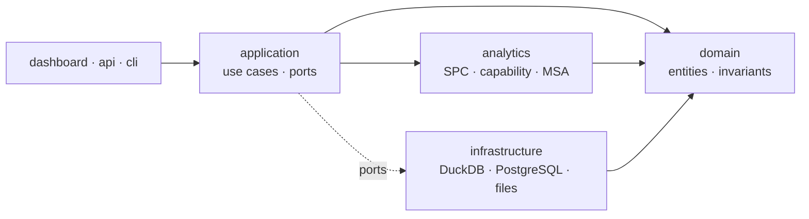

# Semiconductor Manufacturing SPC Monitoring Platform

A Statistical Process Control monitoring platform for semiconductor wafer
fabrication — built to the engineering standard of an internal fab analytics
tool rather than a demonstration project.

> **Status: Phase 7 of 15 complete — domain and configuration.**
> Structure, documentation, requirements, Cursor rules, module design,
> toolchain, and the domain vocabulary with typed configuration are in place.
> The synthetic data generator begins at Phase 8. See
> [PROJECT_PROGRESS.md](docs/PROJECT_PROGRESS.md).

---

## The problem

A wafer fab measures thousands of process parameters continuously. A 300 mm lot
carries 25 wafers, each measured at 5 to 49 sites, across hundreds of process
steps on dozens of tools. The question asked of that data is simple to state
and difficult to answer well:

> **Is this process behaving as it should — and if not, what changed?**

Answering it badly is expensive in both directions. A missed excursion sends
defective material through a process flow that takes weeks to complete. A false
alarm stops a healthy tool, and — worse — teaches operators to dismiss alarms.
A system that cries wolf is worse than no system.

This platform is built around the failure modes that make most SPC tooling
untrustworthy: conflating control limits with specification limits, ignoring
the nested variance structure of wafer data, reporting capability without
qualifying stability or naming the estimator, trusting unqualified metrology,
and enabling every run rule at once.

## What it does

| Capability | Detail |
|---|---|
| **Control charting** | I-MR, X̄-R, X̄-S, EWMA, CUSUM, and attribute charts (p, np, c, u), selected per parameter class rather than applied uniformly |
| **Run-rule detection** | Configurable Western Electric and Nelson rule sets, with the false-alarm cost of each configuration measured, not assumed |
| **Process capability** | Cp, Cpk, Pp, Ppk, Cpm — with short-term and long-term sigma treated as the different things they are, and stability required first |
| **Measurement system analysis** | Gauge R&R by ANOVA, bias, linearity, stability, NDC — because a chart is only as trustworthy as the gauge behind it |
| **Variance decomposition** | Nested separation of within-wafer, wafer-to-wafer, and lot-to-lot contributions, so improvement effort targets the dominant term |
| **Spatial analysis** | Wafer maps and radial/edge signature detection — patterns invisible in a time series that often carry the root cause |
| **Tool and chamber matching** | The most common source of an apparent process shift is a tool-to-tool offset, not the process |
| **Excursion workflow** | Alarm acknowledgement, OCAP linkage, disposition, and an append-only audit trail |

## What makes it different

**The statistics are verified, not asserted.** `tests/statistical/` is a
separate test tier with its own CI stage. Expected values come from
NIST/SEMATECH and Montgomery — every one cited, and every source publicly
obtainable, so a reviewer can check any assertion rather than take it on trust.
Snapshotting current output as an expected value is prohibited, because that
freezes whatever bug exists today.

**Detection is scored against ground truth.** All data is synthetic, generated
with a nested, physically motivated variance structure and deliberately
injected faults of known type, magnitude, and onset. That makes detection rate,
detection latency, localisation accuracy, and false-alarm rate *measurable* —
a claim a real-data project cannot make, because real data has no ground truth
on process state.

**The defining SPC error is structurally impossible.** `SpecificationLimit` and
`ControlLimit` are distinct types with no conversion between them. Drawing spec
limits as control limits cannot be expressed in this codebase.

**False alarms are treated as defects.** Measured ARL₀ is asserted against
theory within ±15%. Sensitivity and false-alarm rate are both acceptance
criteria, because either alone is trivially satisfiable.

**Every number is traceable.** Data revision, code revision, and configuration
revision travel with every chart, capability result, and report.

## Documentation

| Read this | To answer |
|---|---|
| [PROJECT_CONTEXT.md](docs/PROJECT_CONTEXT.md) | What problem is this, who is it for, what is out of scope? |
| [PRODUCT_REQUIREMENTS.md](docs/PRODUCT_REQUIREMENTS.md) | What exactly must it do, and how will we know it does? |
| [SYSTEM_ARCHITECTURE.md](docs/SYSTEM_ARCHITECTURE.md) | How is it built, and where does anything live? |
| [GLOSSARY.md](docs/GLOSSARY.md) | What does this term mean, precisely? |
| [TECH_STACK.md](docs/TECH_STACK.md) | What are we using, and what did we reject? |
| [CODING_STANDARDS.md](docs/CODING_STANDARDS.md) | How must code be written here? |
| [TESTING_STRATEGY.md](docs/TESTING_STRATEGY.md) | How do we know the numbers are right? |
| [DATASET_GUIDE.md](docs/DATASET_GUIDE.md) | What is the data model, and where does data come from? |
| [QUALITY_ASSURANCE_PLAN.md](docs/QUALITY_ASSURANCE_PLAN.md) | How does this fit an IATF 16949 quality system? |
| [DECISION_LOG.md](docs/DECISION_LOG.md) | Why is it done this way? |
| [DEVELOPMENT_ROADMAP.md](docs/DEVELOPMENT_ROADMAP.md) | What is the plan, and what does "done" mean? |
| [RISK_REGISTER.md](docs/RISK_REGISTER.md) | What could go wrong, and what are we doing about it? |
| [DEPLOYMENT_PLAN.md](docs/DEPLOYMENT_PLAN.md) | How does it reach a fab and stay running? |
| [PROJECT_PROGRESS.md](docs/PROJECT_PROGRESS.md) | Where are we right now? |
| [CHANGELOG.md](CHANGELOG.md) | What changed, and when? |

New to the project? Read `PROJECT_CONTEXT`, then `SYSTEM_ARCHITECTURE`, then
`GLOSSARY`. That is enough to contribute.

## Repository layout

```
src/           Application source — the only importable code
dashboard/     Operator and engineer interface
data/          Immutable data zones: raw → interim → processed
notebooks/     Exploration and statistical methodology
tests/         Verification, incl. a dedicated statistical tier
docs/          Architecture, domain, and quality-system documentation
scripts/       Automation, operations, and the synthetic fab generator
configs/       Declarative SPC and process configuration
models/        Statistical baselines and model registry
reports/       Generated quality deliverables
logs/          Runtime logs and the audit trail
.cursor/       AI development environment
.github/       CI quality gates and templates
```

Every directory carries a README explaining its purpose and its rules. Full
rationale in
[docs/architecture/repository-structure.md](docs/architecture/repository-structure.md).

## Architecture in one diagram



Dependencies point inward, always. `domain/` imports nothing from this
repository; `analytics/` imports only `domain/` plus NumPy, SciPy, and
statsmodels. The rule is enforced by `import-linter` in CI, not by convention.

## Technology

Python 3.13 · NumPy · SciPy · statsmodels · pandas · Pandera · Pydantic v2 ·
DuckDB · PostgreSQL + TimescaleDB · FastAPI · Streamlit · Plotly · uv · Ruff ·
mypy · pytest · Hypothesis · Docker · GitHub Actions

Selections and rejected alternatives in [TECH_STACK.md](docs/TECH_STACK.md).

## Getting started

Phases 1–7 established structure, documentation, requirements, Cursor
behavioral controls, module design, toolchain, and the domain model. From
Phase 8 the entry point will grow toward:

```bash
make setup    # uv sync --frozen, install toolchain and package
make check    # the full quality gate set, identical to CI
make demo     # generate synthetic fab data and launch the dashboard
```

The design requirement is that a reviewer can clone the repository and see
working control charts within minutes, with no database and no containers.
That is why the storage layer sits behind a port.

## Roadmap

| Phase | Scope | Status |
|---|---|---|
| 1 | Project structure | ✅ Complete |
| 2 | Project documentation | ✅ Complete |
| 3 | Product requirements | ✅ Complete |
| 4 | Cursor rules | ✅ Complete |
| 5 | Module design | ✅ Complete |
| 6 | Toolchain and CI foundation | ✅ Complete |
| 7 | Domain model and configuration | ✅ Complete |
| 8 | Synthetic fab data generator | Next |
| 9 | SPC analytics engine | Planned |
| 10 | Data pipelines and persistence | Planned |
| 11 | Application layer, API, CLI | Planned |
| 12 | Dashboard | Planned |
| 13 | Reporting, excursion workflow, audit packages | Planned |
| 14 | Deployment and operations | Planned |
| 15 | Advanced analytics | Stretch |

Deliverables and exit criteria per phase in
[DEVELOPMENT_ROADMAP.md](docs/DEVELOPMENT_ROADMAP.md); requirements and
milestones in
[PRODUCT_REQUIREMENTS.md](docs/PRODUCT_REQUIREMENTS.md); the ten modules and
their interfaces in [MODULE_DESIGN.md](docs/MODULE_DESIGN.md).

## Context

Built as a portfolio project for semiconductor quality engineering, targeting
the competency profile of an Advanced Quality Excellence Engineer in a European
automotive-facing fab: applied statistics, semiconductor process knowledge,
quality-system fluency (IATF 16949, MSA, control plans, 8D/CAPA), and the
software engineering discipline that makes analytics trustworthy in production.

**All data is synthetic.** No confidential process data, customer device
information, or proprietary fab parameters appear anywhere in this repository.
