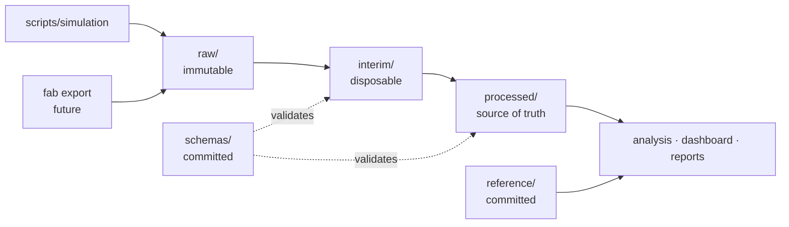

# Dataset Guide

**Document owner:** Project lead
**Status:** Active — design fixed, generator implementation in Phase 8
**Last updated:** 2026-08-03

This document defines the data model, the synthetic data generator, and the
rules governing data movement through the platform. It is the reference for
anyone — human or agent — writing a pipeline stage, a schema, or an analysis.

---

## 1. Why the data is synthetic, and why that is a strength

Wafer-level measurement data is customer-confidential in a foundry context and
is not obtainable outside a fab in any case. Every dataset in this project is
generated by `scripts/simulation/`.

The obvious framing is that this is a limitation. It is closer to the opposite.

Real fab data has no ground truth. When a control chart signals, nobody knows
with certainty whether a genuine shift occurred, when it began, or how large it
was — that is exactly what the investigation is trying to establish. A
detection algorithm evaluated on real data can only be *inspected*, and
"the charts look reasonable" is not evidence.

Synthetic data with **deliberately injected faults of known type, magnitude,
and onset point** allows the engine to be *scored*: detection rate, detection
latency, localisation accuracy, and false-alarm rate, all measured against
truth. See [TESTING_STRATEGY.md](TESTING_STRATEGY.md) §3.5. This is the
strongest claim the project makes about its own correctness, and it is
available precisely because the data is generated.

The requirement this places on the generator is severe: **the synthetic data
must be physically plausible.** A generator producing independent Gaussian
noise would make detection trivially easy and the resulting scores
meaningless. The variance structure below is what makes the benchmark honest.

## 2. The data zones

Data flows one way. No stage writes back into a zone it read from.



| Zone | Contract | Committed | May be read by |
|---|---|---|---|
| `raw/` | Exactly as received. Never edited. | No | Pipeline ingest stage only |
| `external/` | Third-party data with recorded provenance | No | Pipeline |
| `interim/` | Partially transformed; disposable | No | The next pipeline stage only |
| `processed/` | Schema-valid, canonical units, lineage attached | No | Everything downstream |
| `synthetic/` | Generated, with a manifest describing injected faults | No | Pipeline, tests, notebooks |
| `reference/` | Master data: spec limits, tool registry, control plans | **Yes** | Everything |
| `schemas/` | The contracts themselves | **Yes** | Validation |
| `archive/` | Frozen snapshots backing a released report | No | Nothing live |

Two rules carry most of the weight:

**Never edit `raw/`.** A correction applied there is a correction nobody can
audit. If the source is wrong, the fix belongs in a pipeline stage where it is
versioned, tested, and explained.

**Nothing except the pipeline reads `interim/`.** A notebook or dashboard
sourcing from partially transformed data will silently disagree with the
official result, and reconciling the two costs days.

## 3. Data model

### 3.1 Core measurement record

The grain of `processed/` is **one measurement of one parameter at one site on
one wafer at one time**.

| Field | Type | Notes |
|---|---|---|
| `measurement_id` | UUID | Surrogate key |
| `timestamp` | timestamptz | **Always timezone-aware.** Naive datetimes are banned by lint rule. |
| `lot_id` | str | Business key from MES |
| `wafer_id` | str | Composite of lot and slot |
| `slot` | int 1..25 | Position in the FOUP; a legitimate explanatory variable, not just an index |
| `site_id` | int | Index into the sampling plan |
| `site_x`, `site_y` | float (mm) | True coordinates from wafer centre; enables spatial analysis |
| `parameter_id` | str | FK to the parameter registry |
| `value` | float | In the parameter's declared unit |
| `unit` | str | **Stored explicitly, never inferred from the column name** |
| `step_id` | str | Process step / operation |
| `tool_id` | str | Processing equipment |
| `chamber_id` | str | Chamber within the tool |
| `recipe_id` | str | Recipe executed |
| `product_id` | str | Device / technology |
| `metrology_tool_id` | str | The gauge that produced the value — required for MSA linkage |
| `measurement_status` | enum | `valid`, `remeasured`, `superseded`, `suspect` |
| `data_revision` | str | Lineage: which pipeline run produced this row |

The two fields most often omitted from designs like this, and most costly to
add later, are `metrology_tool_id` and `chamber_id`. Without the first, a
measurement cannot be tied to a gauge study; without the second, chamber
mismatch — a leading explanation for apparent process shifts — is invisible.

### 3.2 Reference data (committed)

| Dataset | Contents | Why versioned in git |
|---|---|---|
| `parameters.yaml` | Parameter registry: unit, metrology method, sampling plan, chart type class | Adding a controlled parameter is an engineering decision |
| `specification_limits.yaml` | USL/LSL/target per parameter, product, and step, with effective dates | A spec limit change requires a reviewable history and an approver |
| `tools.yaml` | Tools, chambers, qualification status | A newly qualified tool is a reviewed data change |
| `process_steps.yaml` | Route steps and layer mapping | — |
| `control_plans.yaml` | Per characteristic: control method, sample size, frequency, reaction plan (OCAP) reference | This *is* the specification the platform implements |

Specification limits carry **effective dates**, not just values. When a spec
changes, historical conformance must still be assessable against the limit in
force at the time. Overwriting the value destroys that, and it is the sort of
thing an auditor asks about.

### 3.3 Schemas

Pandera schemas in `data/schemas/` declare, per dataset: column names and
dtypes, nullability, allowed value ranges, categorical membership, key
uniqueness, and cross-field constraints (`lsl < target < usl`; `site_x² +
site_y² ≤ wafer_radius²`).

Validation runs at every zone boundary and is a **hard stop**. Coercing a
malformed measurement into a plausible float is the most dangerous failure
available to this system: it produces a confident wrong answer rather than an
error.

## 4. The synthetic fab generator

`scripts/simulation/` produces data for a fictional 300 mm fab. The
configuration lives alongside the generator so a dataset is fully described by
a config file plus a seed.

### 4.1 Simulated scope

A deliberately small but representative slice — enough to exercise every
analysis type, small enough to comprehend:

| Element | Scope |
|---|---|
| Process steps | ~12 across lithography, etch, deposition, CMP, implant, diffusion |
| Parameters | ~25 (CD, film thickness, overlay x/y, sheet resistance, etch depth, particle count, uniformity) |
| Tools | 2–4 parallel tools per step, 2–6 chambers each |
| Products | 3 devices on 2 technology nodes |
| Volume | Configurable; default ~500 lots over 12 simulated months |
| Sampling | Per-parameter plans: 5, 9, or 13 sites; every lot or every Nth lot |

### 4.2 Variance structure

The part that determines whether the benchmark is honest. Measurements are
composed from nested, physically motivated terms rather than drawn from a
single distribution:

```
value = parameter_target
      + lot_effect              ~ N(0, σ²_lot)          incoming material, queue time
      + tool_offset             fixed per tool          tool-to-tool mismatch
      + chamber_offset          fixed per chamber       chamber mismatch within a tool
      + slot_effect             f(slot)                 systematic position-in-carrier effect
      + spatial_signature       f(site_x, site_y)       radial / edge / asymmetric pattern
      + wafer_effect            ~ N(0, σ²_wafer)        wafer-to-wafer within lot
      + temporal_component      drift / step / cycle    injected fault, if any
      + measurement_error       ~ N(0, σ²_gauge)        the gauge's own contribution
```

Three properties of this structure matter:

**The spatial signature is systematic, not random.** This is what makes the
rational-subgrouping trap real in the generated data: treat sites as a subgroup
and σ̂_within absorbs the radial pattern, the limits widen, and the chart stops
signalling. A generator without this term would let a naive implementation pass
its own benchmark.

**Measurement error is a separate, configurable term.** This is what makes
Gauge R&R analysis meaningful — the %GRR the MSA module computes can be checked
against the σ²_gauge the generator was told to use.

**Tool and chamber offsets are fixed, not resampled.** A tool mismatch is a
persistent bias, and detecting it requires comparison across tools rather than
detection within one time series.

### 4.3 Injected faults

Each carries a manifest recording type, affected entity, onset point, and
magnitude — the ground truth for scoring.

| Fault | Physical analogue | Detection expectation |
|---|---|---|
| **Gradual drift** | Consumable wear, chamber seasoning | EWMA/CUSUM well before Shewhart |
| **Step shift** | Maintenance event, recipe change, part swap | Shewhart rule 1 or 4, quickly |
| **Variance increase** | Degrading component, unstable gas flow | Range/S chart before the mean chart |
| **Cyclic pattern** | Ambient temperature, shift rotation | Run rules for oscillation; visible in autocorrelation |
| **Single tool excursion** | One chamber out of specification | Commonality analysis; invisible in pooled data |
| **Spatial signature change** | Chuck contact, gas distribution | Wafer map; invisible in a time series |
| **Metrology drift** | Gauge calibration slip | MSA stability study — *not* a process fault, and distinguishing the two is the point |
| **Outlier / misrecord** | Data entry or sensor glitch | Should be flagged, not silently absorbed |

The metrology drift case is included deliberately. A platform that reports
gauge drift as a process excursion sends engineers to the wrong tool, and
separating the two is a competency the project intends to demonstrate.

### 4.4 Reproducibility

Every dataset is defined by **generator config + seed + code revision**, all
recorded in a manifest written alongside the data. The same three inputs
reproduce the dataset byte-for-byte. Generated data is never committed;
regenerating it is a single command.

## 5. Data quality handling

Rules for the messiness the generator deliberately reproduces:

| Situation | Handling |
|---|---|
| **Re-measurement** | Both records retained. The superseded one is marked `superseded`, never deleted. Analysis uses `valid` only, but the audit trail keeps both. |
| **Missing measurement** | Recorded as absent. **Never imputed** in the SPC path — an imputed point on a control chart is a fabricated signal. |
| **Out-of-range value** | Quarantined, run fails, human review. Never silently clipped. |
| **Duplicate key** | Pipeline failure. Duplicates mean an upstream problem that dropping rows would conceal. |
| **Unit mismatch** | Converted explicitly with the conversion recorded in lineage, or rejected. Never assumed. |
| **Timezone-naive timestamp** | Rejected at ingest. |
| **Outlier** | **Flagged, never auto-removed.** An outlier may be the excursion the whole system exists to detect. Removal, if any, is an explicit engineering decision recorded in the audit trail. |

The last row is the one most commonly got wrong in analytics pipelines.
Automatic outlier removal is standard practice in many data science contexts
and is actively harmful here: it deletes exactly the signal being monitored.

## 6. Lineage and reproducibility

Every row in `processed/` carries a `data_revision`. Every pipeline run writes
a record to `logs/pipeline/` containing input revision, row counts in and out,
validation results, transformations applied, code revision, config revision,
and timing.

Every analytical output — chart, capability result, report — records the data
revision, code revision, and config revision that produced it. Two copies of
"the September capability report" that disagree must be distinguishable, and
one of them must be identifiable as stale.

**If a result cannot be regenerated from a zone plus three revision
identifiers, that is a defect in the pipeline, not a reason to archive the
artefact.**

## 7. Confidentiality

- No real fab data, ever.
- No real customer, product, or device names. All identifiers are fictional
  and obviously so (`DEV-A28`, `TOOL-ETCH-03`).
- No proprietary process parameters, recipes, or specification values. Targets
  and tolerances are plausible in magnitude and invented in substance.
- Secret scanning (`gitleaks`) runs in CI on every commit.

---

**Related:** [GLOSSARY.md](GLOSSARY.md) ·
[SYSTEM_ARCHITECTURE.md](SYSTEM_ARCHITECTURE.md) ·
[TESTING_STRATEGY.md](TESTING_STRATEGY.md) ·
[QUALITY_ASSURANCE_PLAN.md](QUALITY_ASSURANCE_PLAN.md)
