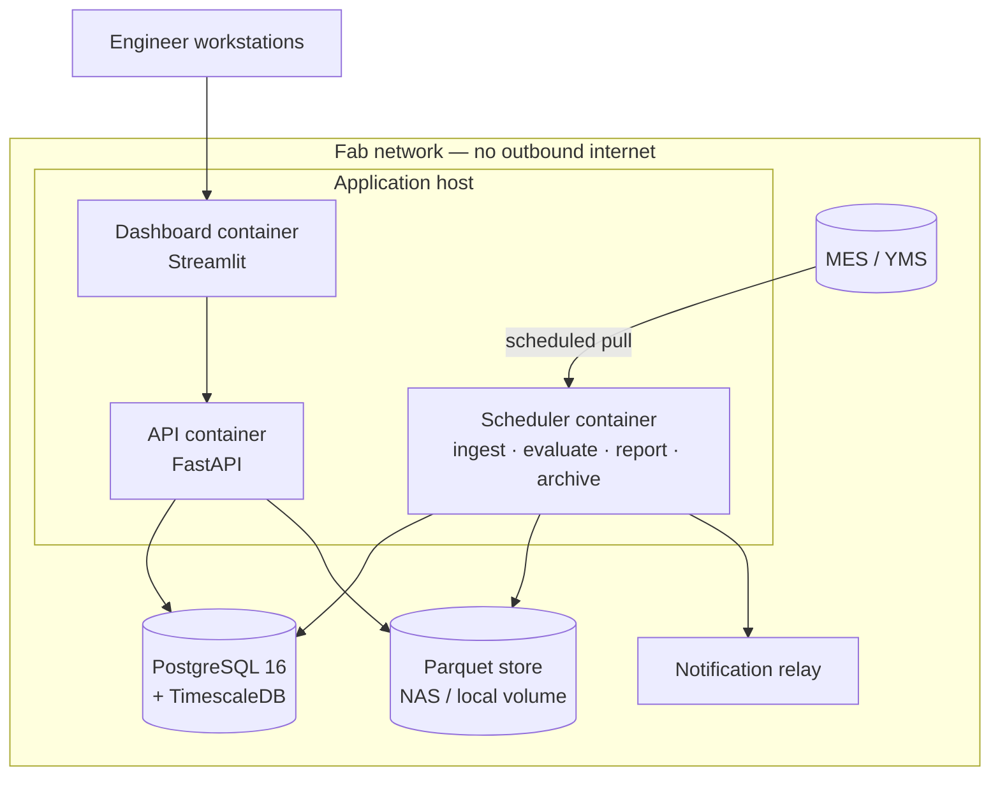

# Deployment Plan

**Document owner:** Project lead
**Status:** Active — implemented in Phase 14 (0.14.0); plan remains authoritative
**Last updated:** 2026-08-10

---

## 1. Deployment context

The controlling constraint is stated in [ADR-0014](DECISION_LOG.md#adr-0014):
**semiconductor fabs do not send process data to public cloud.** Wafer-level
measurement data is customer-confidential and frequently prohibited by contract
from leaving the site. Fab networks are segmented, often without outbound
internet access at all.

Everything below follows from that. There are no managed services, no cloud
object storage, and no third-party API in any request path. Container images
and dependencies are staged into the environment deliberately rather than
pulled at deploy time.

This is not a limitation being worked around. Designing for it is part of what
makes the project a credible representation of fab software.

## 2. Deployment profiles

Three profiles, differing only in configuration. The same artefact runs in all
three.

| | **Local** | **Staging** | **Production** |
|---|---|---|---|
| Purpose | Development, notebooks, review | Integration and contract testing | On-prem fab deployment |
| Storage | DuckDB + Parquet files | PostgreSQL (container) | PostgreSQL 16 + TimescaleDB |
| Services | None | Docker Compose | Docker Compose on a managed host |
| Data | Synthetic, generated on demand | Synthetic, fixed seed | MES-sourced (future adapter) |
| Auth | None | Basic | Site SSO / LDAP |
| Startup | `make demo` | `docker compose up` | Managed by systemd |

### The local profile matters more than it looks

A reviewer must be able to clone the repository and see working control charts
within minutes, with no database, no containers, and no configuration. That
requirement is why the storage layer sits behind a port
([ADR-0008](DECISION_LOG.md#adr-0008)) and why DuckDB is in the stack at all.

```bash
git clone <repo> && cd SPC_Process_Monitoring_System
make setup        # uv sync --frozen; installs the toolchain and the package
make demo         # generates synthetic fab data and launches the dashboard
```

If that sequence ever takes more than a few minutes or requires a running
service, the deployment design has regressed.

## 3. Production topology



Four containers, one host, one database. A modular monolith
([ADR-0013](DECISION_LOG.md#adr-0013)) split into separate containers only
where the runtime profile genuinely differs: a scheduler that runs batch jobs,
a stateless API, and a UI process.

### Sizing

Derived from the scale envelope in
[SYSTEM_ARCHITECTURE.md](SYSTEM_ARCHITECTURE.md) §7 — roughly 10⁶ measurements
ingested daily and 10⁷–10⁸ retained.

| Component | CPU | Memory | Storage |
|---|---|---|---|
| Application host | 8 cores | 32 GB | 100 GB |
| PostgreSQL + TimescaleDB | 8 cores | 64 GB | 2 TB SSD, growing ~500 GB/year before compression |
| Parquet store | — | — | 1 TB |

TimescaleDB compression on measurement hypertables typically reduces the
retained footprint substantially; the figures above are pre-compression and
therefore conservative.

## 4. Container strategy

Multi-stage builds, non-root execution, minimal final images.

```dockerfile
# Stage 1 — build with uv, install into a virtual environment
FROM python:3.13-slim AS builder
COPY --from=ghcr.io/astral-sh/uv:latest /uv /usr/local/bin/uv
WORKDIR /build
COPY pyproject.toml uv.lock ./
RUN uv sync --frozen --no-dev --no-install-project
COPY src/ src/
RUN uv sync --frozen --no-dev

# Stage 2 — runtime only
FROM python:3.13-slim
RUN useradd --create-home --shell /usr/sbin/nologin spc
COPY --from=builder --chown=spc:spc /build/.venv /opt/venv
ENV PATH="/opt/venv/bin:$PATH"
USER spc
HEALTHCHECK --interval=30s --timeout=5s CMD spc-platform health
```

Principles applied:

- **`--frozen` installs.** The lockfile is authoritative. A production build
  that resolves dependencies afresh is not reproducible, and an analysis
  produced by an unreproducible build is not defensible.
- **Non-root**, with no shell for the service account.
- **No build tooling in the runtime image** — smaller attack surface.
- **Images are tagged with the git SHA**, never `latest`. Every running
  container is traceable to an exact code revision, which is what makes the
  provenance header on a report meaningful.
- **Images are scanned before staging** into the fab network, since scanning
  cannot happen there.

## 5. Configuration and secrets

Configuration is layered: `configs/base/` plus an environment overlay, with
overlays kept deliberately small. An overlay that redefines everything is a
second configuration, and it will drift from production and hide bugs where
they cost most.

Secrets never appear in the repository, in an image, or in a log. They are
supplied at runtime as environment variables from the site secret store or
Docker secrets. `configs/secrets/` holds `*.example.yaml` templates documenting
what must be provided; the ignore policy blocks everything else.

The **effective configuration revision hash is recorded on every analytical
output**, so a result can always be traced to the configuration that produced
it.

## 6. Database operations

**Migrations.** Alembic, applied as an explicit deployment step, never
automatically at application start. Automatic migration on startup means an
unplanned schema change during an unrelated restart. Every migration is tested
forward and rolled back in CI.

**Retention.** TimescaleDB policies on the measurement hypertable: compress
after 90 days, retain per site policy. **Audit records are exempt from
compression-driven expiry** and are exported to durable storage on schedule —
their retention is a compliance requirement, not an operational preference.

**Backup.** Nightly `pg_dump` plus continuous WAL archiving to a separate
volume. Parquet store snapshotted weekly.

**Restore is tested, not assumed.** A restore drill is a Phase 14 exit
criterion. An untested backup is a belief about a backup.

## 7. Scheduled jobs

| Job | Cadence | Function |
|---|---|---|
| `ingest` | Every 15 min | Pull new measurements, validate, publish to `processed` |
| `evaluate` | Every 15 min, after ingest | Evaluate against control plans, raise violations |
| `notify` | Every 15 min, after evaluate | Digest and dispatch alarms |
| `daily-report` | Daily 06:00 | Generate the SPC summary |
| `baseline-review` | Weekly | Flag parameters whose baselines are due for review |
| `archive` | Daily 02:00 | Export audit records; rotate logs |
| `backup` | Daily 01:00 | Database dump and Parquet snapshot |

**Every job is idempotent.** A job that corrupts state when run twice will
eventually be run twice — after a failed run, during an incident, or by a
scheduler that double-fires. Verified in Phase 14 by running each job twice and
asserting identical resulting state.

**Alarm notification is digested, not per-violation.** A chamber excursion that
trips forty parameters simultaneously must produce one actionable notification,
not forty pages. Alarm storms are a real operational hazard and a direct cause
of the alarm fatigue the platform is designed to avoid.

## 8. Observability

**Health checks.** `/health` for liveness; `/ready` for readiness including
database connectivity. Container-level `HEALTHCHECK` for restart policy.

**Metrics.** Prometheus-format endpoint: ingestion lag, records processed,
validation failures, evaluation duration, violations raised, job outcomes,
query latency. Scraped by site monitoring if available; otherwise polled by a
local collector.

**Logs.** Structured JSON to stdout, collected by the container runtime.
Correlation IDs across pipeline, application, and API.

**Alerts on the platform itself**, distinct from process alarms:

| Condition | Severity |
|---|---|
| Ingestion lag > 1 hour | High |
| Any scheduled job failed | High |
| Validation failure rate > 1% | High |
| Audit export failed | **Critical** — this is a compliance exposure |
| Database connection failure | Critical |
| Disk > 85% | Medium |

Audit export failure is rated critical deliberately. A gap in the audit trail
cannot be reconstructed after the fact, so the window in which it can be fixed
is short.

## 9. Release process

```
merge to main
  → CI: all gates green (QUALITY_ASSURANCE_PLAN.md §3)
  → build image, tag with git SHA
  → scan image
  → deploy to staging, run smoke suite
  → stage artefacts into the fab network
  → schedule the change window
  → apply migrations
  → deploy, verify health
  → post-deploy verification
```

**Versioning** is semantic, with one domain-specific addition: a change to
statistical behaviour is a **major** version bump regardless of API
compatibility. Changing a sigma estimator retroactively alters the meaning of
every historical number, and that is a breaking change in every sense that
matters to a quality organisation, even when no signature changes.

**Post-deploy verification** re-runs a known reference dataset through the
deployed system and compares against expected values. This is a two-minute
check that catches an entire class of environment-specific numerical problems,
and it is worth doing on every release.

**Rollback:** redeploy the previous image tag. Migrations are reversible;
where a migration cannot be reversed safely, the release is split so that the
schema change and the code change deploy separately.

## 10. Security

- Non-root containers, no shell on service accounts.
- No outbound network access from application containers.
- TLS between the browser and the UI, terminated at the site reverse proxy.
- Authentication via site SSO/LDAP; authorisation by role — engineers view and
  disposition, quality engineers approve baselines, administrators change
  configuration.
- **Every data access is audited.**
- Dependency and image scanning before staging, since it cannot run inside the
  fab network.
- Secrets from the environment only; `gitleaks` in CI as the backstop.

## 11. Disaster recovery

| Scenario | Recovery |
|---|---|
| Application host failure | Redeploy containers on a replacement host; state is entirely in the database and file store |
| Database corruption | Restore from nightly dump plus WAL replay |
| Bad release | Roll back to the previous image tag |
| Data pipeline error producing wrong results | Identify affected outputs by code revision, quarantine, reprocess from `raw/` |
| Audit export gap | Investigate, document, report — treated as a compliance incident |

**Targets:** RPO 24 hours for measurement data (source data remains in the MES
and is re-pullable); RTO 4 hours for the application.

The fourth row is only actionable because every output records the code
revision that produced it. Without that, "which reports are affected?" has no
answer, and the honest response becomes "all of them since the defect was
introduced."

## 12. Kubernetes

Documented as an option, not the base case. A single-host Docker Compose
deployment matches the workload and the operational reality of most fab IT
environments. Kubernetes becomes appropriate if the platform needs
multi-fab deployment, high availability beyond a restart policy, or
horizontal scaling of evaluation. Until one of those is a real requirement, it
would add operational burden without benefit.

---

**Related:** [SYSTEM_ARCHITECTURE.md](SYSTEM_ARCHITECTURE.md) ·
[TECH_STACK.md](TECH_STACK.md) ·
[DECISION_LOG.md](DECISION_LOG.md) ·
[QUALITY_ASSURANCE_PLAN.md](QUALITY_ASSURANCE_PLAN.md)
