# Development Roadmap

**Document owner:** Project lead
**Status:** Active
**Last updated:** 2026-08-04

Fifteen phases, each with explicit deliverables and **exit criteria** — a
phase is complete when its criteria are demonstrably met, not when it feels
finished. Current status is tracked in
[PROJECT_PROGRESS.md](PROJECT_PROGRESS.md); requirements and milestones in
[PRODUCT_REQUIREMENTS.md](PRODUCT_REQUIREMENTS.md).

Effort is indicative for a single engineer working part-time with AI
assistance. Sequencing matters more than the estimates; the ordering below is
deliberate and the rationale is stated where it is not obvious.

---

## Sequencing rationale

Three ordering decisions drive the plan.

**Foundation before code.** Phases 1–6 produce no application logic at all.
Structure, documentation, requirements, the AI development environment, module
design, and tooling come first because every one of them is dramatically more
expensive to retrofit. Adding `mypy --strict` to 10 000 untyped lines is a
project; starting with it is free.

**The data generator precedes the analytics engine.** This looks backwards —
surely you build the thing before the thing that feeds it. But the generator is
what makes the engine *scorable* from its first commit. Building charts first
means evaluating them by eye for weeks; building the generator first means
every detection algorithm is measured against known ground truth the day it is
written.

**The dashboard comes late.** It is the most visible part and the least
load-bearing. Building UI before the engine is correct produces attractive
screenshots of unverified numbers, which is exactly the impression this project
exists to avoid.

---

## Phase 1 — Project structure ✅

**Status:** Complete (2026-08-03) · **Effort:** S · **Milestone:** M1

Production-ready folder structure with per-directory rationale.

**Delivered:** 96-directory tree; README in every top-level folder;
`docs/architecture/repository-structure.md`; scoped ignore policy separating
source from generated artefacts; git repository initialised.

**Exit criteria met:** every directory documented with its purpose and rules;
data, log, model, and report artefacts verified ignored while the skeleton
stays tracked.

---

## Phase 2 — Project documentation ✅

**Status:** Complete (2026-08-03) · **Effort:** M · **Milestone:** M2

The documentation set, written before implementation so that architecture,
standards, and domain vocabulary are settled rather than emergent.

**Delivered:** fifteen documents covering context, architecture, stack,
standards, testing, data, quality system, roadmap, decisions, risk, glossary,
deployment, changelog, and progress tracking.

**Exit criteria met:** a new contributor can answer "what is this, how is it
built, and what may I not do?" from documentation alone; all cross-references
resolve.

---

## Phase 3 — Product requirements ✅

**Status:** Complete (2026-08-04) · **Effort:** M · **Milestone:** M3

The enterprise PRD, establishing the requirement baseline that Phases 4–15
deliver against.

**Delivered:** [PRODUCT_REQUIREMENTS.md](PRODUCT_REQUIREMENTS.md) — executive
summary, problem statement, six business objectives, product and engineering
success metrics, five user personas, scope boundaries, 74 functional
requirements across eleven areas, 43 non-functional requirements in eight
categories, four user story epics, Given/When/Then acceptance criteria,
constraints, dependencies, technical risks, future roadmap, fourteen milestones,
and a four-level definition of done.

**Exit criteria met:** every functional and non-functional requirement carries
an identifier and a priority; the highest-risk behaviours have testable
acceptance criteria; requirements trace to business objectives and to phases.

---

## Phase 4 — Cursor rules ✅

**Status:** Complete (2026-08-04) · **Effort:** S · **Depends on:** Phase 3 ·
**Milestone:** M4

One lightweight global rule plus path-scoped behavioral controls that give the
agent the correct professional role and project constraints without loading
irrelevant instructions.

**Delivered**
- `project-core.mdc` — always-applied source-of-truth routing, uncertainty
  handling, scope discipline, and universal safety constraints
- `product-manager.mdc` — requirements, stories, acceptance criteria, planning,
  prioritization, and change control
- `semiconductor-quality-engineer.mdc` — fab vocabulary, SPC, capability, MSA,
  quality systems, root-cause rigor, and manufacturing change control
- `senior-python-architect.mdc` — dependency direction, SOLID, modular Python,
  patterns, reuse, and performance
- `testing-engineer.mdc` — pytest, test tiers, regression evidence, mocking,
  coverage, and CI behavior
- `github-maintainer.mdc` — branches, pull requests, Conventional Commits,
  issues, Actions, and repository hygiene
- `documentation-writer.mdc` — Markdown, API and architecture documentation,
  ADRs, READMEs, and technical writing

**Exit criteria met**
- Every rule has one responsibility and valid `.mdc` frontmatter
- `project-core.mdc` is the only always-applied rule and stays minimal
- All six specialist rules use narrow path scopes and `alwaysApply: false`
- Every rule stays under 50 lines
- Rules cite the authoritative project documents rather than duplicating them
- The anti-fabrication, control/spec-limit, estimator, and independent-reference
  controls for R-20 are present before statistical implementation

---

## Phase 5 — Module design ✅

**Status:** Complete (2026-08-04) · **Effort:** M · **Depends on:** Phase 3 ·
**Milestone:** M5

The functional decomposition into ten modules, and the map from those modules
onto the layers they are built inside — settled before the toolchain so that
`import-linter` contracts and package structure encode a decomposition that
already exists.

**Delivered**
- [MODULE_DESIGN.md](MODULE_DESIGN.md) — the module index: what a module is in
  this project, the ten modules at a glance, the dependency graph, the
  requirement coverage map, and the conventions binding on all ten
- Ten specifications in [modules/](modules/), each stating purpose,
  responsibilities, public interfaces, dependencies, expected inputs and
  outputs, files to create, testing requirements, documentation required, and
  future extension points
- A recorded scope boundary: four capabilities that exceed the requirement
  baseline are listed as **proposed** requirement identifiers rather than
  assumed, and nothing may be built against them until the PRD is amended

**Exit criteria met**
- Every functional requirement area in [PRODUCT_REQUIREMENTS.md](PRODUCT_REQUIREMENTS.md)
  §7 has an owning module; no area is unowned
- The module dependency graph is acyclic and consistent with the inward-only
  layering rule, with modules defined as capability slices rather than packages
- Every module names the files it creates in directories that already exist
- Capabilities beyond the requirement baseline are recorded as proposals, not
  implemented as assumptions

---

## Phase 6 — Toolchain and CI foundation

**Effort:** M · **Depends on:** Phase 5 · **Milestone:** M6

The mechanical quality gates, in place before the first line of application
code so that nothing is ever written outside them.

**Deliverables**
- `pyproject.toml` (PEP 621) with the src layout, `requires-python = ">=3.13,<3.14"`
  ([ADR-0016](DECISION_LOG.md#adr-0016)), `uv` environment, and committed `uv.lock`
- Ruff, `mypy --strict`, pytest with markers per test tier, coverage
- `import-linter` contracts encoding the inward-only dependency rule and the
  module dependency graph in [MODULE_DESIGN.md](MODULE_DESIGN.md) §3
- `pre-commit` hooks including `nbstripout` and `gitleaks`
- `Makefile` / task runner exposing every check as one command
- GitHub Actions: the full gate sequence from
  [QUALITY_ASSURANCE_PLAN.md](QUALITY_ASSURANCE_PLAN.md) §3
- Issue and pull request templates, `CODEOWNERS`

**Exit criteria**
- `make check` runs the entire gate set locally and matches CI exactly
- A deliberately introduced layering violation is caught by `import-linter`
- A deliberately committed fake secret is caught by `gitleaks`
- CI is green on an empty codebase

---

## Phase 7 — Domain model and configuration ✅

**Status:** Complete (2026-08-04) · **Effort:** M · **Depends on:** Phase 6 ·
**Milestone:** M7

The vocabulary of the fab as types, and the typed configuration system.

**Delivered**
- Entities and value objects per [SYSTEM_ARCHITECTURE.md](SYSTEM_ARCHITECTURE.md) §3.1
- **`SpecificationLimit` and `ControlLimit` as structurally distinct,
  non-convertible types** (FR-C06)
- `Measurement` carrying value, unit, timestamp, and provenance (FR-D01)
- Layered typed settings (`base/` + environment overlay) with unknown keys
  raising (FR-CF02) and an effective configuration revision hash
- Reference data under `data/reference/`: parameters, spec limits, tools,
  steps, control plans
- Pandera schemas for raw / interim / processed zone boundaries

**Exit criteria met**
- Every domain invariant has a test that violates it and expects a raise
- It is impossible to construct a `ControlLimit` from a specification, or the
  reverse — demonstrated by a type-level test
- `domain/` imports nothing from this repository; verified by `import-linter`
- Unknown configuration keys raise rather than being ignored (FR-CF02)

---

## Phase 8 — Synthetic fab data generator ✅

**Status:** Complete (2026-08-04) · **Effort:** L · **Depends on:** Phase 7 ·
**Milestone:** M8

The measurement instrument for everything that follows.

**Delivered**
- Fab model: 12 steps, 26 parameters, 27 process tools across 80 chambers, 15
  gauges, 3 products, 6 control plans charting 44 characteristics
- Nested variance structure per [DATASET_GUIDE.md](DATASET_GUIDE.md) §4.2 —
  lot, tool offset, chamber offset, slot effect, **systematic spatial
  signature**, wafer effect, separate gauge error
- Injected faults with ground-truth manifests: drift, step shift, variance
  increase, cyclic, single-tool excursion, spatial change, metrology drift,
  outliers — eight in the default configuration, all unlabelled in the data
- Realistic messiness: re-measurements retaining both records, missing points
  written as absent rows rather than nulls, optional bad records
- Deterministic reproduction from config + seed + code revision, verified
  through the storage boundary in Parquet and CSV
- Independent statistical validators that report what they could *not* check,
  and skip any check whose tolerance exceeds the quantity it is checking
- `src/spc_platform/simulation/` as a package with thin operator scripts, held
  in place by two `import-linter` contracts
  ([ADR-0021](DECISION_LOG.md#adr-0021))

**Exit criteria met**
- 153 statistical checks pass on the default 500-lot dataset; every quantity the
  manifest declares is realised within tolerance
- The spatial signature reproduces across wafers at correlation > 0.95, and
  removing it is caught — it is systematic, not noise
- Variance decomposition recovers lot, within-wafer, spatial, and per-tool
  components; between-tool variance is positive wherever tool mismatch is
  configured
- A dataset regenerates with an identical content digest, and the digest
  survives a round trip through both storage formats
- Every injected fault is shown present in the data with the declared
  magnitude, onset, and scope

**Throughput:** about 125,000 measurements per second; the default 226,000-row
dataset builds in roughly two seconds at 153 MiB peak.

**Why this was Large:** getting the variance structure physically plausible was
the hard part, and it determines whether every later benchmark is honest. A
generator emitting independent Gaussian noise would make detection trivial and
the scores meaningless (R-30).

---

## Phase 9 — SPC analytics engine ✅

**Status:** Complete (2026-08-05) · **Effort:** XL · **Depends on:** Phases 7, 8 ·
**Milestone:** M9

The core of the project, and the part on which its credibility rests.

**Delivered**
- Charts: I-MR, X̄-R, X̄-S, EWMA, CUSUM, p, np, c, u — Phase I studies and
  Phase II panels with fixed limits (FR-C01, FR-C03)
- Run rules: Western Electric and Nelson, composed from vectorised primitives,
  with measured ARL₀ (FR-R01 – FR-R06)
- Capability: Cp, Cpk, Pp, Ppk, Cpm; short- and long-term sigma named on every
  result; non-normal handling (FR-P01 – FR-P08)
- MSA: Gauge R&R by ANOVA, bias, linearity, stability, NDC, with configured
  acceptance bands (FR-M01 – FR-M04)
- Nested variance decomposition (FR-S07)
- Spatial signature classification: radial, edge, asymmetric, or **none**,
  with none as the default (FR-S02)
- Estimator constants (d₂, c₄, A₂, D₃, D₄, …) derived from their integral
  definitions and checked against Montgomery Appendix VI
- Detection scorecard harness scored against known onsets
  ([TESTING_STRATEGY.md](TESTING_STRATEGY.md) §3.5);
  `docs/validation/detection-performance.md` publishes the numbers
- `configs/spc/` chart defaults and named rule sets

**Exit criteria met**
- Reference cases from NIST/SEMATECH and Montgomery pass in
  `tests/statistical/analytics/`
- Measured ARL₀ within ±15% of theory for Shewhart alone and Western Electric
- Detection rate 100% at 1.5σ and at 3σ across 200 seeded trials; localisation
  99% within ±3 points at 3σ
- 1 000 points with Nelson's full rule set under the 50 ms budget (NFR-P01)
- `analytics/` imports only `domain/`, `common/`, and the approved numerical
  stack; the module-graph contract holds over the new `spatial/` and
  `scoring/` packages

**Not in this phase (and not claimed):** detector registries and activation
gates (FR-AD01 – FR-AD04, proposed); application use cases (Phase 11);
dashboard rendering (Phase 12).

---

## Phase 10 — Data pipelines and persistence ✅

**Effort:** L · **Depends on:** Phases 7, 8 · **Milestone:** M10
**Completed:** 2026-08-06

**Deliverables**
- Pipeline stages: ingest → validate → normalise units → resolve
  re-measurements → attach context → subgroup → publish
- Schema validation as a hard stop with quarantine (FR-D02, FR-D03)
- Lineage recording on every row and every run (FR-D09)
- Repository adapters for DuckDB (local) and PostgreSQL/TimescaleDB
  (production), behind one port
- Alembic migrations
- Baseline store: versioned, immutable, with supersession (FR-CF04, FR-AU04)

**Exit criteria**
- ~~The same contract test suite passes against DuckDB, PostgreSQL, and the
  in-memory fake~~ ✅ (PostgreSQL when `SPC_TEST_DATABASE_URL` is set)
- ~~A malformed record fails the run and is quarantined — never silently coerced~~ ✅
- ~~Every processed row carries a resolvable `data_revision`~~ ✅
- ~~Migrations apply forward and roll back cleanly~~ ✅ (PostgreSQL when URL set;
  revision unit-tested without a server)

---

## Phase 11 — Application layer, API, and CLI ✅

**Status:** Complete (2026-08-06) · **Effort:** M · **Depends on:** Phases 9, 10 ·
**Milestone:** M11

**Deliverables**
- Use cases: evaluate lot, recompute baseline, acknowledge violation, record
  disposition, generate capability report, run gauge study, get wafer map
- Application policy, notably **refusing a capability report on an
  out-of-control process** (FR-P04)
- FastAPI surface with a generated OpenAPI contract
- Typer CLI for scheduled jobs and backfills
- Append-only audit trail wired into every consequential action (FR-AU01 -
  FR-AU03)

**Exit criteria**
- ~~Every use case is tested with fake adapters, including refusal paths~~ ✅
- ~~API responses validate against the OpenAPI schema in `tests/contract/`~~ ✅
- ~~Every auditable event from [QUALITY_ASSURANCE_PLAN.md](QUALITY_ASSURANCE_PLAN.md)
  §2.2 that these use cases emit produces a complete record~~ ✅
- ~~CLI and API demonstrably invoke the same use cases~~ ✅

**Deferred (by design):** site SSO to Phase 14; no message bus (TECH_STACK).

---

## Phase 12 — Dashboard ✅

**Status:** Complete (2026-08-07) · **Effort:** L · **Depends on:** Phase 11 ·
**Milestone:** M12

**Deliverables**
- Line overview ordered by what needs attention
- Control chart viewer with violation markers and point drill-down
- Capability screen stating estimator, n, and window
- Wafer map: interactive Plotly with site drill-down, wafer boundary and notch,
  deviation heatmaps, and lot/wafer/tool/chamber filtering
  ([ADR-0018](DECISION_LOG.md#adr-0018))
- Tool and chamber comparison (Welch's t-test, FR-T01)
- Alarm and disposition queue with OCAP field (linked when present)
- MSA screen
- Theme with **visually distinct treatment of spec versus control limits**, and
  accessible signalling that never relies on colour alone

**Exit criteria**
- ~~Zero statistical computation in `dashboard/`; every number comes from a use
  case~~ ✅ (import-linter + AST unit test)
- ~~Spec and control limits are visually unambiguous~~ ✅
- ~~Out-of-control state is distinguishable without colour vision~~ ✅ (shape + label)
- ~~Chart load under 1 s warm; stale data after a baseline change is impossible~~ ✅
  (cache keys include data/config revision; wafer-map assembly budget pinned)
- ~~Wafer map colour scale is fixed across any comparison set and uses only
  perceptually uniform scales; a `tests/performance/` case pins the ~5 000
  marker budget, and exceeding it degrades to an aggregated view that says so~~ ✅
- ~~The same `WaferMapView` renders both the interactive figure and the static
  report export, verified by a test asserting they describe identical data~~ ✅

**Deferred:** Module 5 KPI trends (proposed FRs); full PDF reports (Phase 13).

---

## Phase 13 — Reporting, excursion workflow, and audit packages ✅

**Status:** Complete (2026-08-10) · **Effort:** M · **Depends on:** Phases 11, 12 ·
**Milestone:** M13

**Deliverables**
- Report templates: SPC summary, capability study, MSA report, excursion
  summary (FR-RP01)
- Deterministic HTML → PDF rendering with a provenance header on every
  artefact (FR-RP02, FR-RP03)
- Excursion workflow: detection → containment → commonality analysis →
  disposition → closure, with 8D/CAPA references (FR-A01 – FR-A07)
- Audit package assembly: charts, data extract, limits in force,
  configuration revision, disposition records (FR-RP04)

**Exit criteria**
- ~~Every report regenerates identically from data + code + config revisions~~ ✅
  (HTML contract tests; PDF when WeasyPrint system libraries are present)
- ~~Every statistic in every report carries n and window~~ ✅
- ~~An audit package is independently verifiable by its recipient~~ ✅
  (zip + SHA-256 + provenance manifest)

**Deferred:** site SSO and containerised WeasyPrint runtime libs to Phase 14.

---

## Phase 14 — Deployment and operations · Complete (0.14.0)

**Effort:** M · **Depends on:** Phase 13 · **Milestone:** M14

**Deliverables**
- Multi-stage Docker images, non-root, minimal
- Docker Compose for the local and staging profiles
- Scheduled jobs: ingest, evaluate, report, archive
- Health checks, metrics, log shipping
- Runbooks for the failure modes in `docs/runbooks/`
- Backup, restore, and retention procedures

**Exit criteria**
- One command brings up a working stack with demonstration data
- All scheduled jobs are idempotent — verified by running each twice (NFR-R01)
- Restore from backup is tested, not assumed (NFR-R03)
- Every runbook has been executed at least once

**Done.** `make stack` / Compose local+staging; scheduler jobs with double-run
fingerprints; `/health` `/ready` `/metrics`; backup/restore drill and runbooks.

---

## Phase 15 — Advanced analytics (stretch)

**Effort:** L · **Depends on:** Phase 14 · **Milestone:** M15

Attempted only when everything above is complete and solid. Half-finished
advanced features are worth less than none, because they invite the question of
what else is half-finished (R-10).

**Candidates**
- Multivariate SPC: Hotelling T², PCA-based monitoring
- Drift forecasting with a model card, evaluated on detection lead time
- Automated commonality analysis across tool, chamber, and material
- Anomaly detection augmenting — never replacing — rule-based SPC

**Exit criteria**
- Every model has a card stating assumptions, degradation, and when it must
  **not** be used
- Every model is scored on the ground-truth benchmark, including false-alarm
  rate
- Rule-based SPC remains the primary detection mechanism

---

## Indicative sequence

```mermaid
gantt
    dateFormat X
    axisFormat %s
    section Foundation
    P1 Structure           :done, 0, 1
    P2 Documentation       :done, 1, 2
    P3 Requirements        :done, 3, 1
    P4 Cursor rules        :done, 4, 1
    P5 Module design       :done, 5, 1
    P6 Toolchain + CI      :done, 6, 2
    section Core
    P7 Domain model        :done, 8, 2
    P8 Data generator      :10, 3
    P9 Analytics engine    :13, 5
    section Platform
    P10 Pipelines + storage :18, 3
    P11 Application + API  :21, 2
    P12 Dashboard          :23, 3
    P13 Reporting + audit  :26, 2
    section Operations
    P14 Deployment         :28, 2
    P15 Advanced (stretch) :30, 3
```

Units are relative effort, not calendar time. Phase 9 dominates, which is
correct: it is the phase that carries the project's central claim.

## Definition of done, project-wide

The project is complete when a fab engineer can clone it, run one command, and
within minutes see control charts on realistic data — then verify from
`docs/validation/` and `tests/statistical/` that the numbers are right, read
`docs/` to understand every decision, and find nothing that looks like a
tutorial.

Story-, phase-, release-, and project-level criteria are set out in
[PRODUCT_REQUIREMENTS.md](PRODUCT_REQUIREMENTS.md) §16.

---

**Related:** [PRODUCT_REQUIREMENTS.md](PRODUCT_REQUIREMENTS.md) ·
[MODULE_DESIGN.md](MODULE_DESIGN.md) ·
[PROJECT_PROGRESS.md](PROJECT_PROGRESS.md) ·
[PROJECT_CONTEXT.md](PROJECT_CONTEXT.md) ·
[RISK_REGISTER.md](RISK_REGISTER.md) ·
[CHANGELOG.md](../CHANGELOG.md)
