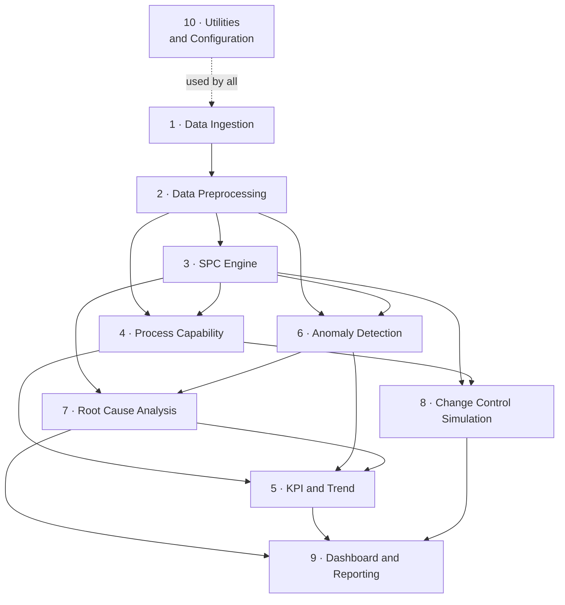

# Module Design

**Document owner:** Project lead
**Status:** Active — design baseline for Phases 6–15; no module implemented yet
**Version:** 1.0 · 2026-08-04

The functional decomposition of the platform into ten modules, and the map from
those modules onto the layered architecture they are built inside. This document
is the index; each module has its own specification under
[modules/](modules/).

For the layer boundaries and dependency rule see
[SYSTEM_ARCHITECTURE.md](SYSTEM_ARCHITECTURE.md); for the requirements each
module delivers against see
[PRODUCT_REQUIREMENTS.md](PRODUCT_REQUIREMENTS.md); for sequencing see
[DEVELOPMENT_ROADMAP.md](DEVELOPMENT_ROADMAP.md).

---

## 1. What a module is in this project

A module here is a **capability slice**, not a Python package. Each module owns
one engineering capability end to end, and its parts are distributed across the
existing hexagonal layers according to what each part does.

This distinction is load-bearing and is recorded as
[ADR-0019](DECISION_LOG.md#adr-0019). Ten top-level packages named after the ten
modules would place statistical computation, orchestration, and I/O inside the
same import unit, which breaks the inward-only dependency rule that
`import-linter` enforces ([SYSTEM_ARCHITECTURE.md](SYSTEM_ARCHITECTURE.md) §2)
and makes `analytics/` impure — at which point the statistical test tier is no
longer possible. The modules are a decomposition of *responsibility*; the layers
remain the decomposition of *dependency*.

| A module part that… | Lives in | Regardless of which module owns it |
|---|---|---|
| Expresses a fab concept or invariant | `src/spc_platform/domain/` | Imports nothing from this repository |
| Computes a statistic | `src/spc_platform/analytics/` | Pure, no I/O, arrays not DataFrames |
| Coordinates an engineering action and applies policy | `src/spc_platform/application/` | Depends on ports it defines itself |
| Moves data between zones | `src/spc_platform/pipelines/` | Records lineage at every stage |
| Touches a database, file, or external system | `src/spc_platform/infrastructure/` | Implements an application-defined port |
| Renders something | `dashboard/` | Contains zero computation |
| Is cross-cutting configuration, logging, or audit | `config/`, `common/`, `observability/` | Parsed once at the boundary |

Two consequences follow, and both are enforced rather than encouraged. A module
never imports another module's application or infrastructure code — it depends
on a port or on a domain type. And a module's analytics code is reachable from
its application code, never the reverse.

## 2. The ten modules

| # | Module | Answers | Owning layers | Delivered in |
|---|---|---|---|---|
| 1 | [Data Ingestion](modules/01-data-ingestion.md) | Did this data arrive intact, and can I prove where it came from? | pipelines, infrastructure | Phase 10 |
| 2 | [Data Preprocessing](modules/02-data-preprocessing.md) | Is this series analysis-ready without having been quietly altered? | pipelines, domain | Phase 10 |
| 3 | [Statistical Process Control Engine](modules/03-spc-engine.md) | Is this process in control, and which rule signalled? | analytics, application | Phase 9, 11 |
| 4 | [Process Capability Analysis](modules/04-process-capability.md) | Can this process meet the specification, and can the gauge see it? | analytics, application | Phase 9, 11 |
| 5 | [KPI and Trend Analysis](modules/05-kpi-and-trend.md) | How is quality performance moving across parameters, tools, and areas? | analytics, application | Phase 11, 13 |
| 6 | [Anomaly Detection](modules/06-anomaly-detection.md) | What signalled, how well does detection perform, and by what contract? | analytics, application | Phase 8, 9 |
| 7 | [Root Cause Analysis](modules/07-root-cause-analysis.md) | What evidence bears on this excursion, and what did the engineer decide? | analytics, application, domain | Phase 9, 11, 13 |
| 8 | [Change Control Simulation](modules/08-change-control-simulation.md) | What would this proposed change have done to detection and to history? | application, analytics | Phase 11 |
| 9 | [Dashboard and Reporting](modules/09-dashboard-and-reporting.md) | Can the right person see and defend this result? | dashboard, application, infrastructure | Phase 12, 13 |
| 10 | [Utilities and Configuration](modules/10-utilities-and-configuration.md) | Is this run configured, traceable, and auditable? | config, common, observability | Phase 7, 11 |

## 3. Module dependency graph

`M10` is omitted from the other edges for legibility: every module depends on
it for configuration, units, time, provenance, error types, and audit.

The graph is acyclic and must stay that way. Two directions that look plausible
and are prohibited: Module 3 must not depend on Module 7 (an SPC chart never
consults root-cause evidence), and Module 9 must not be depended on by anything
(presentation is always a leaf).

## 4. Requirement coverage

Every functional requirement area in [PRODUCT_REQUIREMENTS.md](PRODUCT_REQUIREMENTS.md)
§7 maps to an owning module. An area with no owner is a design defect.

| Requirement area | Owning module(s) |
|---|---|
| 7.1 Data ingestion and integrity (FR-D01 – FR-D11) | 1, with FR-D05 – FR-D08 in 2 |
| 7.2 Control charting (FR-C01 – FR-C09) | 3 |
| 7.3 Run-rule detection (FR-R01 – FR-R06) | 3, with FR-R05 – FR-R06 shared with 6 and 8 |
| 7.4 Process capability (FR-P01 – FR-P09) | 4 |
| 7.5 Measurement system analysis (FR-M01 – FR-M06) | 4 |
| 7.6 Spatial and variance analysis (FR-S01 – FR-S07) | 6 (FR-S02), 7 (FR-S07), 9 (FR-S01, S03 – S06) |
| 7.7 Tool and chamber analysis (FR-T01 – FR-T03) | 7 |
| 7.8 Excursion and alarm workflow (FR-A01 – FR-A07) | 7 (record and link), 9 (queue, notification) |
| 7.9 Reporting (FR-RP01 – FR-RP05) | 9 |
| 7.10 Audit and traceability (FR-AU01 – FR-AU06) | 10 |
| 7.11 Configuration and administration (FR-CF01 – FR-CF05) | 10 |

## 5. Capabilities proposed but not approved

Four of the ten modules reach past the current requirement baseline. Rather than
inventing requirements, the gap is recorded here. **The identifiers below are
proposals. They are not in the PRD, carry no priority, and nothing may be built
against them until they are approved and the PRD is amended.**

| Proposed ID | Capability | Module | Why it is not covered today |
|---|---|---|---|
| FR-K01 – FR-K06 | KPI definition, aggregation, recurrence, and excursion aging | 5 | The PRD has quality-manager trend screens as a persona need and BO-5 as an objective, but no functional requirement defining the KPI set |
| FR-AD01 – FR-AD04 | Detector contract, registry, and detection-performance scoring as a product capability | 6 | Ground-truth scoring exists today only as a test obligation ([TESTING_STRATEGY.md](TESTING_STRATEGY.md) §3.5), not as a platform feature |
| FR-RC01 – FR-RC04 | Evidence bundle assembly, the no-cause-assertion constraint, and the insufficient-evidence outcome | 7 | The individual computations are required (FR-T01, FR-T02, FR-S07); their assembly into one evidence artefact is not |
| FR-CC01 – FR-CC06 | Change request record, what-if replay, and mandatory impact statement before approval | 8 | FR-R06 requires an ARL impact statement but nothing requires the machinery that produces one, and no requirement covers replaying history under a proposed configuration |

Two scope boundaries are held rather than proposed away:

**Module 7 does not determine causes.** [SYSTEM_ARCHITECTURE.md](SYSTEM_ARCHITECTURE.md)
§10 records automated root-cause determination as a deliberate non-goal, and the
PRD excludes it. The module is scoped to assembling evidence — commonality,
variance decomposition, tool and chamber comparison, spatial signature — each
item stating its statistical test, effect size, and sample size. The engineer
concludes, and the conclusion is recorded as a human disposition.

**Module 6 does not add model-based detection in this release.** Multivariate
SPC, PCA monitoring, and drift forecasting remain gated behind Phase 15 (R-10).
What Module 6 delivers now is the contract every detector must satisfy and the
harness that scores detection performance, so that a future model enters through
an audited path rather than beside it.

## 6. What the ten modules do not cover

Recorded so that absence is not mistaken for oversight.

**The domain model is shared, not owned.** `src/spc_platform/domain/` is the
vocabulary all ten modules speak. Each module specification lists the domain
types it introduces, but no module owns the package, and a type introduced by
one module is used freely by others. Domain remains the innermost layer.

**The synthetic fab generator is an instrument, not a module.** It lives in
`scripts/simulation/` and `data/synthetic/`, is delivered in Phase 8, and exists
to make Module 6's scoring possible ([DATASET_GUIDE.md](DATASET_GUIDE.md)). It
is not part of the shipped application and nothing in `src/` imports it.

**The toolchain and CI gates are not a module.** They are Phase 6
infrastructure around all ten ([QUALITY_ASSURANCE_PLAN.md](QUALITY_ASSURANCE_PLAN.md) §3).

## 7. Conventions binding on every module

These hold across all ten and are not restated in each specification.

1. **Every output carries provenance** — data revision, code revision, and
   configuration revision (FR-RP02, BO-4). A result object without them is
   incomplete, and a contract test says so.
2. **Every statistic carries n, window, and estimator** (FR-P03, FR-P09,
   NFR-U04). There is no parameter named `sigma` anywhere
   ([CODING_STANDARDS.md](CODING_STANDARDS.md) §1.1).
3. **Refusal is a designed output, not a failure.** A module that cannot compute
   a result raises a typed error carrying context; it never substitutes a
   default (§1.4). Refusal paths are tested as thoroughly as success paths.
4. **Specification limits and control limits never meet.** No module converts
   between them, and none accepts one where the other is expected (§1.5).
5. **Analytics is pure.** No module logs, reads, writes, or reads a clock inside
   `analytics/`. Time is injected.
6. **Configuration is typed and parsed once**, at the application boundary, with
   an unknown key raising (FR-CF02).
7. **Every statistical formula cites a publicly obtainable source** — NIST/SEMATECH
   or Montgomery, per [ADR-0017](DECISION_LOG.md#adr-0017).

## 8. Phase delivery map

Modules are not built one at a time. Each is delivered across the phases that
own its layers.

| Phase | Milestone | Module work delivered |
|---|---|---|
| 7 — Domain model and configuration | M7 | Module 10 configuration, units, time, error taxonomy; the domain types every module declares |
| 8 — Synthetic fab data generator | M8 | Module 6 ground-truth manifest contract and scoring inputs |
| 9 — SPC analytics engine | M9 | Modules 3, 4, 6, 7 analytics; the statistical test tier |
| 10 — Data pipelines and persistence | M10 | Modules 1 and 2 in full; baseline store for Module 8 |
| 11 — Application layer, API, CLI | M11 | Application layer of Modules 3, 4, 5, 7, 8; Module 10 audit trail |
| 12 — Dashboard | M12 | Module 9 screens and the `WaferMapView` seam |
| 13 — Reporting, excursion workflow, audit packages | M13 | Module 9 reports and packages; Module 7 excursion workflow; Module 5 trend reporting |
| 15 — Advanced analytics (stretch) | M15 | Module 6 model-based detectors, entering through the contract defined in Phase 9 |

---

**Related:** [SYSTEM_ARCHITECTURE.md](SYSTEM_ARCHITECTURE.md) ·
[PRODUCT_REQUIREMENTS.md](PRODUCT_REQUIREMENTS.md) ·
[DEVELOPMENT_ROADMAP.md](DEVELOPMENT_ROADMAP.md) ·
[CODING_STANDARDS.md](CODING_STANDARDS.md) ·
[TESTING_STRATEGY.md](TESTING_STRATEGY.md) ·
[GLOSSARY.md](GLOSSARY.md)
