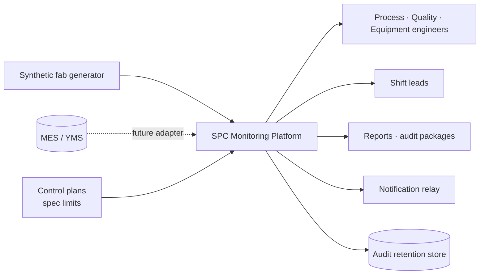

# Product Requirements Document

**Product:** Semiconductor Manufacturing SPC Monitoring Platform
**Document owner:** Project lead
**Status:** Approved — baseline for Phases 4–15
**Version:** 1.0 · 2026-08-04

---

## 1. Executive summary

A wafer fab measures thousands of process parameters continuously and must
answer one question on every shift: **is this process behaving as it should,
and if not, what changed?**

Answering it badly is expensive in both directions. A missed excursion sends
defective material through a process flow that takes weeks to complete, and in
an automotive supply chain the escape may reach a customer. A false alarm stops
a healthy tool and — more damagingly — teaches operators to dismiss alarms. A
system that cries wolf is worse than no system, because it destroys the trust
that makes the real alarm actionable.

This platform performs Statistical Process Control for semiconductor wafer
fabrication: control charting across the standard chart family, run-rule
detection with quantified false-alarm behaviour, process capability with
correct sigma handling, measurement system analysis, spatial signature
detection on wafer maps, tool and chamber matching, and an excursion workflow
with a defensible audit trail.

Three properties distinguish it from a charting tool:

1. **Statistical results are verified against published references**, not
   asserted. Every expected value in the validation suite cites a publicly
   obtainable source.
2. **Detection performance is measured, not claimed.** All data is synthetic
   with deliberately injected faults of known type, magnitude, and onset, so
   detection rate, latency, and false-alarm rate are quantities rather than
   impressions.
3. **Every reported number is traceable and reproducible** from a data
   revision, a code revision, and a configuration revision — which is what
   makes it usable as evidence in an IATF 16949 context.

The platform is built as a portfolio demonstration of Advanced Quality
Excellence Engineering competency for a European automotive-facing fab. It is
not a commercial MES or YMS replacement.

## 2. Problem statement

### 2.1 The operational problem

Modern CMOS routes run 400–1200 process steps. A 300 mm lot carries 25 wafers,
each measured at 5–49 sites under a defined sampling plan, across hundreds of
parameters on dozens of parallel tools with multiple chambers each. A
mid-volume fab generates millions of measurement records per day.

Detecting a genuine process shift within that volume — early enough to contain
material, and reliably enough that engineers trust the signal — is the problem.

### 2.2 Why existing approaches fail

Each of these is a documented failure mode in real fab analytics tooling, and
each is a design constraint for this product.

| Failure mode | Consequence |
|---|---|
| **Specification limits drawn as control limits** | The chart cannot detect a shift until material is already non-conforming — too late by definition |
| **Sites treated as a rational subgroup** | The systematic within-wafer radial signature inflates σ̂_within, limits widen, the chart never signals, and the team concludes "SPC doesn't work here" |
| **Capability reported without qualification** | A Cpk with no stated sample size, window, sigma estimator, or stability evidence is a number with a Greek letter attached |
| **Unqualified metrology trusted** | If gauge R&R consumes 40% of tolerance, the chart is substantially plotting the measurement system rather than the process |
| **Every run rule enabled everywhere** | ARL₀ falls from ~370 to ~91 with the four Western Electric rules; alarm fatigue follows, and the real alarm is dismissed with the rest |
| **Unreproducible analysis** | A capability study whose inputs were overwritten and whose cleaning steps lived in a deleted notebook cell cannot be defended in an audit |

### 2.3 Problem statement

> Process and quality engineers in a wafer fab lack a monitoring platform that
> is simultaneously **statistically correct**, **operationally trustworthy**
> (low false-alarm rate, sensitive to real shifts), and **auditable** to
> automotive quality standards. Existing tools compromise on at least one, and
> the compromise is usually invisible until it has produced a wrong decision.

## 3. Business objectives

| ID | Objective | Measure of success |
|---|---|---|
| **BO-1** | Detect genuine process excursions early enough to contain material | Detection rate ≥ 95% for shifts ≥ 1.5σ; detection latency within theoretical ARL₁ + tolerance |
| **BO-2** | Maintain engineer trust in the alarm signal | Measured ARL₀ within ±15% of theory for every configured rule set |
| **BO-3** | Produce capability and MSA evidence acceptable to a customer or auditor | 100% of reported statistics carry estimator, sample size, window, and stability status |
| **BO-4** | Make every reported number reproducible and traceable | 100% of outputs carry data, code, and configuration revision |
| **BO-5** | Direct improvement effort at the dominant variance source | Variance decomposition available for every controlled parameter |
| **BO-6** | Demonstrate Advanced Quality Excellence Engineering competency | Statistical correctness verifiable by an independent reviewer without trusting the author |

BO-1 and BO-2 are stated as a pair deliberately. Either alone is trivially
satisfiable — signal on everything, or signal on nothing. Only the pair
describes a system an engineer would use.

## 4. Success metrics

### 4.1 Product metrics (the primary bar)

| Metric | Target | Verified by |
|---|---|---|
| Detection rate, shifts ≥ 1.5σ | ≥ 95% | Ground-truth scoring against injected faults |
| Detection rate, shifts ≥ 3σ | ≥ 99% | Ground-truth scoring |
| Detection latency | Within theoretical ARL₁ + tolerance | Ground-truth scoring |
| Fault localisation (signal within ±3 points of onset) | ≥ 80% | Ground-truth scoring |
| Measured ARL₀ deviation from theory | Within ±15% | Simulation over in-control series |
| Reference-validated statistical cases passing | 100% | `tests/statistical/` |
| Statistics reported without n, window, and estimator | 0 | Contract tests + review |
| Outputs lacking full provenance | 0 | Contract tests |

### 4.2 Engineering metrics

| Metric | Target |
|---|---|
| Type coverage (`mypy --strict`) | 100%, no exemptions in `domain/` or `analytics/` |
| Architecture violations (`import-linter`) | 0 |
| Coverage in `domain/` and `analytics/` | Near-exhaustive; no regression permitted |
| Secret-scan findings | 0 |
| Performance budgets met | 100% (see §8.1) |

### 4.3 Portfolio metrics

Qualitative, and the reason the project exists. A fab engineer reviewing the
repository should conclude, without being told: the statistics are right and
independently checkable; the domain distinctions that matter are handled
correctly; the engineering is production-grade; and quality-system thinking is
present rather than bolted on.

## 5. Target users

### 5.1 Primary personas

**Process engineer — "Is my process stable, and if it moved, when and on which
tool?"**
Owns one or more process steps. Uses the platform daily, usually starting from
a specific parameter. Needs chart, limits, violation context, tool comparison,
and wafer map in one place. Statistically literate; will not accept a number
without knowing how it was computed. *Primary screens: control chart viewer,
tool/chamber comparison, wafer map.*

**Quality engineer — "Can I defend this number to a customer?"**
Owns capability evidence, MSA status, and control plan conformance. Uses the
platform in bursts, around PPAP submissions, customer audits, and quarterly
reviews. Needs regenerable reports with complete provenance. *Primary screens:
capability, MSA, report generation, audit package assembly.*

**Equipment engineer — "Is this chamber behaving differently from its
siblings?"**
Owns tool health. Needs chamber-level resolution, drift behaviour after
maintenance, and matched-tool deviation. *Primary screens: tool/chamber
comparison, drift view, equipment state overlay.*

**Shift lead / operator — "What needs attention right now, and what do I do?"**
Under time pressure, possibly at 03:00. Needs a prioritised queue and a
predetermined reaction plan, not an analysis environment. *Primary screens:
line overview, alarm queue with OCAP linkage.*

**Quality manager — "Where are the systemic issues?"**
Needs trend across areas, open excursion count, and recurrence patterns.
*Primary screens: summary dashboards, generated reports.*

### 5.2 Design priority

The **shift lead's question is answered first**, because it is asked most often
and under the most pressure. A screen that requires three clicks to reveal
whether a point violated a rule has failed that user, regardless of how well it
serves the others.

## 6. System scope

### 6.1 System context

### 6.2 In scope

- Univariate SPC across I-MR, X̄-R, X̄-S, EWMA, CUSUM, and attribute charts
- Western Electric and Nelson run rules, configurable per parameter
- Process capability including non-normal handling
- Measurement system analysis (Gauge R&R, bias, linearity, stability)
- Nested variance decomposition
- Wafer map spatial signature detection
- Tool and chamber matching, commonality analysis
- Excursion workflow: acknowledgement, OCAP linkage, disposition, audit trail
- Report generation and audit package assembly
- Synthetic fab data generation with ground-truth injected faults
- Batch and scheduled evaluation

### 6.3 Out of scope

| Excluded | Reason |
|---|---|
| Real-time equipment control or interlocks | Safety-rated concern with different engineering requirements |
| Full MES or YMS functionality | Not the problem being solved |
| Ingestion of real proprietary fab data | Confidential and unobtainable; synthetic by design |
| Automated root-cause determination | The platform assembles evidence; the engineer concludes |
| Sub-second streaming from equipment | No use case requires it; batch meets the need |
| FDC / trace-data analysis | Adjacent discipline, separate platform |
| OEE and equipment productivity reporting | Vocabulary aligned (SEMI E79); feature explicitly excluded |
| Multivariate SPC, drift forecasting | Deferred to Phase 15, gated on everything prior |

## 7. Functional requirements

Priority uses MoSCoW: **M** must, **S** should, **C** could, **W** won't (this
release).

Twenty further requirements were **proposed** during Phase 5 module design and
are recorded in [MODULE_DESIGN.md](MODULE_DESIGN.md) §5. They are not part of
this baseline, carry no priority, and are not implementable until this document
is amended to include them.

### 7.1 Data ingestion and integrity

| ID | Requirement | Pri |
|---|---|---|
| FR-D01 | Ingest measurement records with full context: lot, wafer, slot, site ID and coordinates, parameter, value, unit, timestamp, step, tool, chamber, recipe, product, metrology tool | M |
| FR-D02 | Validate every record against a declared schema at each data zone boundary | M |
| FR-D03 | On schema violation, quarantine the batch and fail the run. Never coerce a malformed value | M |
| FR-D04 | Reject timezone-naive timestamps at ingest | M |
| FR-D05 | Retain re-measurements; mark the superseded record rather than deleting it | M |
| FR-D06 | Never impute a missing measurement in the SPC path | M |
| FR-D07 | Flag outliers; never remove them automatically | M |
| FR-D08 | Perform unit conversion explicitly and record it in lineage; never assume a unit | M |
| FR-D09 | Record lineage: a data revision per row, and a run record per pipeline execution with counts in and out | M |
| FR-D10 | Fail the run on duplicate keys rather than dropping rows | M |
| FR-D11 | Expose a repository port permitting a future MES/YMS adapter without changes to analytics | S |

### 7.2 Control charting

| ID | Requirement | Pri |
|---|---|---|
| FR-C01 | Support I-MR, X̄-R, X̄-S, EWMA, CUSUM, and p, np, c, u attribute charts | M |
| FR-C02 | Select chart type per parameter from control plan configuration, not by a global default | M |
| FR-C03 | Compute control limits **only** from a qualified, approved baseline | M |
| FR-C04 | Record the subgrouping strategy on every subgroup produced | M |
| FR-C05 | Raise a typed error when no active baseline exists. Never substitute a default limit | M |
| FR-C06 | Represent specification limits and control limits as non-interchangeable types, and render them visually distinctly | M |
| FR-C07 | Compute zone boundaries (1σ, 2σ, 3σ) for run-rule evaluation | M |
| FR-C08 | Support EWMA λ and CUSUM k/h as per-parameter configuration | S |
| FR-C09 | Overlay equipment state transitions (SEMI E10) on the chart time axis | S |

### 7.3 Run-rule detection

| ID | Requirement | Pri |
|---|---|---|
| FR-R01 | Implement Western Electric rules 1–4 | M |
| FR-R02 | Implement the Nelson eight-rule set | S |
| FR-R03 | Configure the active rule set per parameter, not globally | M |
| FR-R04 | Record on every violation: rule identity, severity, chart, point, and timestamp | M |
| FR-R05 | Report the measured ARL₀ for each configured rule set | M |
| FR-R06 | Require an ARL impact statement for any rule set configuration change | M |

### 7.4 Process capability

| ID | Requirement | Pri |
|---|---|---|
| FR-P01 | Compute Cp, Cpk, Pp, Ppk | M |
| FR-P02 | Compute Cpm | S |
| FR-P03 | Name the sigma estimator explicitly on every result; never accept an unqualified "sigma" | M |
| FR-P04 | Refuse to produce a capability result for a process not demonstrated to be in control | M |
| FR-P05 | Enforce a configured minimum sample size before reporting an index | M |
| FR-P06 | Assess normality and record the assessment with the result | M |
| FR-P07 | Support non-normal capability via transformation (Box-Cox, Johnson) or percentile method, recording the method used | S |
| FR-P08 | Handle single-sided specifications correctly | M |
| FR-P09 | Report sample size, time window, estimator, and stability status alongside every index | M |

### 7.5 Measurement system analysis

| ID | Requirement | Pri |
|---|---|---|
| FR-M01 | Compute Gauge R&R by the ANOVA method | M |
| FR-M02 | Report %GRR of tolerance and of total variation, and NDC | M |
| FR-M03 | Apply configured acceptance bands and state an acceptability judgement | M |
| FR-M04 | Compute bias, linearity, and stability | S |
| FR-M05 | Link every measurement to its metrology tool | M |
| FR-M06 | Flag parameters whose gauge is unqualified or whose study has expired | S |

### 7.6 Spatial and variance analysis

| ID | Requirement | Pri |
|---|---|---|
| FR-S01 | Render a wafer map at true site coordinates in mm from wafer centre | M |
| FR-S02 | Classify spatial signature: radial, edge, asymmetry, or none | S |
| FR-S03 | Fix colour scale limits across any comparison set and display them numerically | M |
| FR-S04 | Use only perceptually uniform, colour-vision-safe colour scales | M |
| FR-S05 | Provide site-level drill-down: lot, wafer, slot, site, coordinates, value, unit, deviation | M |
| FR-S06 | Above the configured point budget, degrade to an aggregated view and state on screen that it has done so | M |
| FR-S07 | Decompose variance into within-wafer, wafer-to-wafer, and lot-to-lot components | S |

### 7.7 Tool and chamber analysis

| ID | Requirement | Pri |
|---|---|---|
| FR-T01 | Compare matched parameters across parallel tools and chambers with a stated statistical test | M |
| FR-T02 | Perform commonality analysis across tool, chamber, recipe, and material for a set of affected lots | S |
| FR-T03 | Surface chamber-level resolution wherever tool-level data is shown | M |

### 7.8 Excursion and alarm workflow

| ID | Requirement | Pri |
|---|---|---|
| FR-A01 | Present an open violation queue ordered by severity and age | M |
| FR-A02 | Record acknowledgement with actor and timestamp | M |
| FR-A03 | Require a disposition with a reason: continue, hold, rework, scrap, or use-as-is | M |
| FR-A04 | Link every alarm to the OCAP defined for that characteristic in the control plan | M |
| FR-A05 | Dispatch digested notifications, never one per violation | M |
| FR-A06 | Escalate unacknowledged violations after a configured interval | S |
| FR-A07 | Reference an 8D or CAPA identifier on excursion closure | C |

### 7.9 Reporting

| ID | Requirement | Pri |
|---|---|---|
| FR-RP01 | Generate SPC summary, capability study, MSA report, and excursion summary | M |
| FR-RP02 | Include a provenance header on every artefact: data, code, and configuration revision, generation timestamp, and parameters used | M |
| FR-RP03 | Regenerate any report deterministically from those revisions | M |
| FR-RP04 | Assemble a self-contained audit package: charts, data extract, limits in force at the time, configuration revision, disposition records | S |
| FR-RP05 | Render wafer maps in reports from the same view object the dashboard renders | M |

### 7.10 Audit and traceability

| ID | Requirement | Pri |
|---|---|---|
| FR-AU01 | Maintain an append-only audit trail, separate from operational logs | M |
| FR-AU02 | Record actor, timestamp, before and after state, and reason for every consequential action | M |
| FR-AU03 | Audit control limit changes, baseline creation and supersession, violation acknowledgement and disposition, configuration changes, report generation, and measurement data access | M |
| FR-AU04 | Retain superseded baselines so a historical violation remains explainable against the limits in force at the time | M |
| FR-AU05 | Export audit records to durable retention storage on schedule | M |
| FR-AU06 | Expose audit records for query through the API | S |

### 7.11 Configuration and administration

| ID | Requirement | Pri |
|---|---|---|
| FR-CF01 | Express process knowledge declaratively: chart selection, rule sets, tool and parameter registries, control plans | M |
| FR-CF02 | Validate configuration on load; treat an unknown key as an error | M |
| FR-CF03 | Carry effective dates on specification limits and retain historical values | M |
| FR-CF04 | Version baselines with approver and effective date; never overwrite | M |
| FR-CF05 | Authenticate via site SSO/LDAP with role-based authorisation | S |

## 8. Non-functional requirements

### 8.1 Performance

| ID | Requirement |
|---|---|
| NFR-P01 | Chart computation — 1 000 points, limits plus full rule set — under 50 ms |
| NFR-P02 | Lot evaluation across all parameters at one step under 2 s |
| NFR-P03 | Dashboard chart load under 1 s with warm cache |
| NFR-P04 | Wafer map render within the interaction budget at or below 5 000 markers |
| NFR-P05 | Nightly full re-evaluation under 30 min |
| NFR-P06 | Ingestion sustained at 10⁶ records/day |
| NFR-P07 | Computation vectorised, not per-point |

### 8.2 Scalability

| ID | Requirement |
|---|---|
| NFR-S01 | 10⁷–10⁸ retained measurement records |
| NFR-S02 | ~2 000 parameters under active control |
| NFR-S03 | Storage retention and compression policy on time-series data |

### 8.3 Reliability and availability

| ID | Requirement |
|---|---|
| NFR-R01 | Every scheduled job idempotent — verified by executing twice and asserting identical state |
| NFR-R02 | RPO 24 h for measurement data; RTO 4 h for the application |
| NFR-R03 | Restore from backup tested, not assumed |
| NFR-R04 | Pipeline failure leaves no partial state in `processed/` |

### 8.4 Correctness

| ID | Requirement |
|---|---|
| NFR-C01 | Every statistical result validated against a publicly obtainable published reference |
| NFR-C02 | Statistical validation runs as its own CI stage, separately reported |
| NFR-C03 | Expected values never derived from current implementation output |
| NFR-C04 | Analytical invariants hold under property-based testing |
| NFR-C05 | Measured ARL₀ within ±15% of theory |

### 8.5 Security

| ID | Requirement |
|---|---|
| NFR-SE01 | No outbound network access from application containers |
| NFR-SE02 | Containers run non-root with no shell on service accounts |
| NFR-SE03 | Secrets supplied at runtime from the environment or a secret store; never from a file or an image |
| NFR-SE04 | Role-based authorisation: engineers view and disposition, quality engineers approve baselines, administrators change configuration |
| NFR-SE05 | All measurement data access audited |
| NFR-SE06 | Dependency and image scanning before staging into the fab network |
| NFR-SE07 | No measured values, credentials, or customer device names in operational logs |

### 8.6 Usability and accessibility

| ID | Requirement |
|---|---|
| NFR-U01 | The operator question — "is this normal, and if not, what do I do?" — answerable within one screen |
| NFR-U02 | Specification and control limits visually unambiguous and never interchangeable |
| NFR-U03 | Out-of-control state distinguishable by shape and label, never by colour alone |
| NFR-U04 | Every displayed statistic accompanied by sample size and time window |
| NFR-U05 | The interface never invents a value; an uncomputable result is stated as such |
| NFR-U06 | Cached data invalidated by data or configuration revision change |

### 8.7 Maintainability

| ID | Requirement |
|---|---|
| NFR-M01 | Full type annotation under `mypy --strict` |
| NFR-M02 | Inward-only dependency rule enforced mechanically in CI |
| NFR-M03 | Every statistical formula and constant cites a source |
| NFR-M04 | No module-level side effects |
| NFR-M05 | Documentation updated in the same pull request as the change |

### 8.8 Portability and compliance

| ID | Requirement |
|---|---|
| NFR-PO01 | Runs on-premises with no runtime dependency on any external service |
| NFR-PO02 | Local profile runs with no database server and no containers |
| NFR-PO03 | Single pinned Python version, deployed identically to what CI validated |
| NFR-CO01 | Audit records satisfy ALCOA+ principles |
| NFR-CO02 | Traceability from any measurement to lot, wafer, slot, tool, chamber, recipe, and metrology tool |
| NFR-CO03 | Terminology aligned to AIAG and SEMI conventions |

## 9. User stories

### Epic A — Monitor process stability

**US-A1** · *As a process engineer, I want to see a control chart for a
parameter with its limits and violation markers, so that I can tell at a glance
whether the process is stable.*

**US-A2** · *As a process engineer, I want to click a point and see its lot,
wafer, slot, tool, chamber, and value, so that I can begin an investigation
without leaving the screen.*

**US-A3** · *As a process engineer, I want equipment state transitions marked
on the chart, so that I can see whether a shift coincides with maintenance.*

**US-A4** · *As a process engineer, I want to be told when no qualified
baseline exists rather than shown default limits, so that I never act on a
fabricated boundary.*

### Epic B — Investigate an excursion

**US-B1** · *As a shift lead, I want a queue of open violations ordered by
severity, so that I know what needs attention first.*

**US-B2** · *As a shift lead, I want each alarm to link to its OCAP, so that I
can follow the predetermined reaction plan rather than improvise.*

**US-B3** · *As a process engineer, I want to compare a parameter across
parallel tools and chambers, so that I can determine whether an apparent
process shift is actually a tool offset.*

**US-B4** · *As a process engineer, I want a wafer map with site drill-down, so
that I can identify a spatial signature and its physical cause.*

**US-B5** · *As a quality engineer, I want to record a disposition with a
reason, so that the decision is traceable.*

### Epic C — Demonstrate capability

**US-C1** · *As a quality engineer, I want Cp, Cpk, Pp, and Ppk with the sigma
estimator stated, so that I can report the right index for the right question.*

**US-C2** · *As a quality engineer, I want the system to refuse a capability
result on an unstable process, so that I never submit an index describing a
distribution that does not exist.*

**US-C3** · *As a quality engineer, I want a capability report regenerable from
its data and code revisions, so that I can defend it in an audit.*

**US-C4** · *As a quality engineer, I want Gauge R&R results with an
acceptability judgement, so that I know whether to trust the underlying data.*

### Epic D — Maintain the system

**US-D1** · *As a quality engineer, I want to recalculate a baseline through an
approved workflow that retains the previous version, so that historical
violations remain explainable.*

**US-D2** · *As a quality engineer, I want the ARL impact of a rule set change
stated before I approve it, so that I do not unknowingly increase false
alarms.*

**US-D3** · *As an administrator, I want configuration changes to fail loudly
on an unknown key, so that a typo does not silently disable a rule.*

## 10. Acceptance criteria

Representative criteria for the highest-risk stories, in Given/When/Then form.
Every story carries criteria of this kind; those below define the pattern and
the bar.

**AC-A4 · No baseline, no chart** *(US-A4, FR-C05)*
> **Given** a parameter with no approved active baseline
> **When** a user requests its control chart
> **Then** the system raises `NoActiveBaselineError` naming the parameter,
> the UI states that no qualified baseline exists,
> **and** no chart is rendered with substituted or default limits.

**AC-C2 · Capability refused on an unstable process** *(US-C2, FR-P04)*
> **Given** a parameter with open violations inside the requested window
> **When** a capability report is requested
> **Then** the system declines, stating that the process is not demonstrated to
> be in control,
> **and** no Cp, Cpk, Pp, or Ppk value is returned or displayed.

**AC-C1 · Estimator always stated** *(US-C1, FR-P03, FR-P09)*
> **Given** any capability result returned by the platform
> **When** it is rendered in the UI, an API response, or a report
> **Then** it carries the sigma estimator, sample size, time window, and
> stability status,
> **and** a contract test fails if any of the four is absent.

**AC-B2 · Alarm carries its reaction plan** *(US-B2, FR-A04)*
> **Given** a violation raised on a characteristic defined in a control plan
> **When** the shift lead opens it in the queue
> **Then** the OCAP reference for that characteristic is displayed,
> **and** the violation cannot be closed without a disposition and a reason.

**AC-D1 · Baseline supersession preserves history** *(US-D1, FR-AU04, FR-CF04)*
> **Given** an active baseline with recorded violations against it
> **When** a new baseline is approved for that parameter
> **Then** the previous baseline is marked superseded and retained,
> the audit trail records actor, timestamp, and reason,
> **and** the historical violations still resolve to the limits in force when
> they were raised.

**AC-S3 · Wafer map colour scale does not fabricate a signature** *(FR-S03, FR-S04)*
> **Given** a set of wafers displayed for comparison
> **When** the wafer maps are rendered
> **Then** all use identical colour scale limits, displayed numerically,
> the scale is perceptually uniform and colour-vision-safe,
> **and** per-wafer autoscaling is applied only when explicitly requested and
> labelled.

**AC-R05 · False-alarm behaviour is measured** *(US-D2, FR-R05, NFR-C05)*
> **Given** a configured rule set
> **When** it is evaluated over a simulated in-control process
> **Then** the measured ARL₀ is reported,
> **and** the build fails if it deviates from theory by more than 15%.

### Release-level acceptance

A release is acceptable when every **M** requirement is met, all §4.1 product
metrics are achieved, every CI gate is green, and no **S1** defect is open.

## 11. Constraints

| ID | Constraint | Consequence |
|---|---|---|
| **CON-1** | No real fab data is available or permitted | All data synthetic; realism of the generator becomes a project risk (R-30) |
| **CON-2** | Deployment is on-premises and network-restricted | No cloud services, no external runtime dependencies, artefacts staged deliberately |
| **CON-3** | Single developer, AI-assisted | Explicit rules and documentation replace peer review; AI failure modes need designed-out controls |
| **CON-4** | AIAG and SEMI publications are licensed | Conceptual alignment only; never a numerical test dependency |
| **CON-5** | Statistical correctness must be independently verifiable | Reference sources restricted to publicly obtainable publications |
| **CON-6** | Single pinned Python version | Interpreter change is a revalidation exercise, not a routine bump |
| **CON-7** | Portfolio project, finite effort | Advanced analytics gated behind completion of everything prior |

## 12. Dependencies

### 12.1 Technical

| Dependency | Purpose | Risk if unavailable |
|---|---|---|
| NumPy, SciPy, statsmodels | Numerical and statistical primitives | High — no substitute of equivalent maturity |
| pandas, PyArrow | Tabular handling and Parquet I/O | Low — confined to pipelines, analytics takes arrays |
| Pandera, Pydantic v2 | Schema and object validation | Medium — replaceable with effort |
| DuckDB, PostgreSQL + TimescaleDB | Storage | Low — behind a repository port |
| Streamlit, Plotly | Presentation | Low — dashboard holds no logic |
| FastAPI, Typer | API and CLI surfaces | Low |
| uv, Ruff, mypy, pytest, Hypothesis | Toolchain | Medium |

### 12.2 Informational

| Dependency | Purpose | Status |
|---|---|---|
| NIST/SEMATECH e-Handbook | Numerical reference values | Publicly available |
| Montgomery, *Introduction to Statistical Quality Control*, 8th ed. | Numerical reference values | Required |
| AIAG SPC / MSA | Terminology, acceptance bands | Conceptual alignment only |
| SEMI standards | Equipment model, state, substrate, timestamp conventions | Conceptual alignment only |
| IATF 16949 / ISO 9001 | Quality system alignment | Conceptual alignment only |

### 12.3 Sequencing dependencies

The synthetic data generator (Phase 8) precedes the analytics engine (Phase 9),
so that detection can be **scored against ground truth from the first commit**
rather than assessed by eye. Toolchain and AI environment precede all
implementation, because retrofitting `mypy --strict`, the layering rules, or
the anti-fabrication controls is far more expensive than starting with them.

## 13. Technical risks

Full register with scoring, mitigations, and triggers in
[RISK_REGISTER.md](RISK_REGISTER.md). The highest-impact entries for this
product:

| ID | Risk | Score | Product consequence |
|---|---|---|---|
| R-20 | AI fabrication of statistical constants | 20 → Low residual | A wrong constant produces confidently wrong numbers; designed out via mandatory citation, reference tests, and an agent rule |
| R-04 | Rational subgrouping error | 16 | Limits too wide, chart never signals, BO-1 unmet |
| R-21 | Helpful fallbacks reintroducing silent failure | 16 | Fabricated values where an error should surface, violating FR-C05 and NFR-U05 |
| R-01 | Incorrect statistical implementation | 15 | Plausible wrong numbers; the reason for the statistical test tier |
| R-02 | Wrong estimator silently applied | 15 | Misstated capability; designed out at the API level |
| R-06 | Silent data corruption in the pipeline | 15 | Wrong charts with no error raised |
| R-05 | Excessive false alarms | 12 | BO-2 unmet; alarm fatigue destroys adoption |
| R-08 | Capability on an unstable process | 12 | Indefensible evidence; prevented by FR-P04 |
| R-30 | Synthetic data insufficiently realistic | 12 | All §4.1 detection metrics become meaningless |
| R-43 | Visualisation fabricating a spatial signature | 12 | Wrong engineering conclusion from a rendering artefact |
| R-12 | Documentation drift | 12 | The specification stops describing the system |

The pattern across the highest scores is consistent: **the dangerous defects
produce a plausible wrong answer rather than a failure.** Nothing crashes,
nothing turns red, and the number is acted on. Every control in this product is
aimed at that class.

## 14. Future roadmap

Beyond the current release scope. Each requires the release-level acceptance in
§10 to be met first.

| Horizon | Capability | Rationale |
|---|---|---|
| Next | Multivariate SPC — Hotelling T², PCA-based monitoring | Correlated parameters signal jointly before any single one does |
| Next | Automated commonality analysis across tool, chamber, recipe, material | The standard first step in an excursion investigation, currently manual |
| Later | Drift forecasting with a model card and lead-time evaluation | Containment before the limit is crossed |
| Later | Real MES/YMS ingestion adapter | The repository port already exists for it |
| Later | Multi-fab deployment | Would justify revisiting the Kubernetes decision |
| Speculative | FDC / trace-data integration | Different data volume and latency profile; likely a separate platform |
| Speculative | OEE integration feeding SEMI E79 quality efficiency | Vocabulary already aligned; feature deliberately excluded |

Any predictive capability enters through the same application ports as
rule-based detection, so it augments the audit trail rather than bypassing it.
**Rule-based SPC remains the primary detection mechanism** — a control chart an
engineer can read, explain, and defend in an audit is not replaceable by a model
that cannot be.

## 15. Milestones

| # | Milestone | Phase | Exit condition |
|---|---|---|---|
| M1 | Repository structure | 1 ✅ | Every directory documented; ignore policy verified |
| M2 | Documentation baseline | 2 ✅ | Architecture, standards, and vocabulary settled |
| M3 | Product requirements | 3 ✅ | This document approved |
| M4 | Cursor rules configured | 4 ✅ | One lightweight global core plus six path-scoped specialist rules validate |
| M5 | Module design baseline | 5 ✅ | Every requirement area has an owning module; the module dependency graph is acyclic and respects the layering rule |
| M6 | Quality gates operational | 6 | `make check` matches CI; layering violation and planted secret both caught |
| M7 | Domain model complete | 7 ✅ | Spec and control limits provably non-interchangeable; every invariant tested |
| M8 | Generator producing scoreable data | 8 | Variance decomposition recovers configured components; datasets byte-reproducible |
| M9 | **Analytics engine validated** | 9 | All reference cases pass; ARL₀ within ±15%; detection ≥ 95% at 1.5σ |
| M10 | Data flowing end to end | 10 | Same contract suite passes on DuckDB, PostgreSQL, and the fake |
| M11 | Application layer complete | 11 | Every use case tested including refusals; audit trail complete |
| M12 | Dashboard usable | 12 | Zero computation in `dashboard/`; limits visually unambiguous |
| M13 | Reporting and audit packages | 13 | Every report deterministically regenerable |
| M14 | Deployable | 14 | One command brings up a working stack; restore drill executed |
| M15 | Advanced analytics | 15 | Stretch; every model carries a card and a ground-truth score |

**M9 is the milestone that matters.** It is where the product's central claim —
that the statistics are correct and the detection performance is measured —
becomes demonstrable. Everything before it is preparation; everything after is
delivery.

## 16. Definition of done

### 16.1 Story level

- [ ] Acceptance criteria met and demonstrable
- [ ] Unit tests passing; statistical tests added where behaviour is numerical
- [ ] Types complete under `mypy --strict`
- [ ] No architecture violation
- [ ] Refusal paths tested, not only success paths
- [ ] Documentation and `.cursor/rules/` updated in the same pull request
- [ ] No invented defaults, silent fallbacks, or swallowed exceptions

### 16.2 Phase level

- [ ] Every phase exit criterion in [DEVELOPMENT_ROADMAP.md](DEVELOPMENT_ROADMAP.md) demonstrably met
- [ ] All CI gates green
- [ ] No coverage regression in `domain/` or `analytics/`
- [ ] Risk register reviewed; new risks recorded
- [ ] `PROJECT_PROGRESS.md` and `CHANGELOG.md` updated

### 16.3 Release level

- [ ] Every **M** requirement in §7 and §8 met
- [ ] Every §4.1 product metric achieved and evidenced
- [ ] Statistical validation complete against the full reference set
- [ ] Detection performance scored against ground truth and recorded in `docs/validation/`
- [ ] Every output carries complete provenance
- [ ] Audit trail complete for every event in FR-AU03
- [ ] Deployment verified, including a restore drill
- [ ] No open S1 or S2 defect

### 16.4 Project level

The project is done when a fab engineer can clone the repository, run one
command, and within minutes see control charts on realistic data — then verify
from `docs/validation/` and `tests/statistical/` that the numbers are right,
read `docs/` to understand every decision, and find nothing that looks like a
tutorial.

---

**Related:** [PROJECT_CONTEXT.md](PROJECT_CONTEXT.md) ·
[SYSTEM_ARCHITECTURE.md](SYSTEM_ARCHITECTURE.md) ·
[MODULE_DESIGN.md](MODULE_DESIGN.md) ·
[DEVELOPMENT_ROADMAP.md](DEVELOPMENT_ROADMAP.md) ·
[TESTING_STRATEGY.md](TESTING_STRATEGY.md) ·
[QUALITY_ASSURANCE_PLAN.md](QUALITY_ASSURANCE_PLAN.md) ·
[RISK_REGISTER.md](RISK_REGISTER.md) ·
[GLOSSARY.md](GLOSSARY.md)
