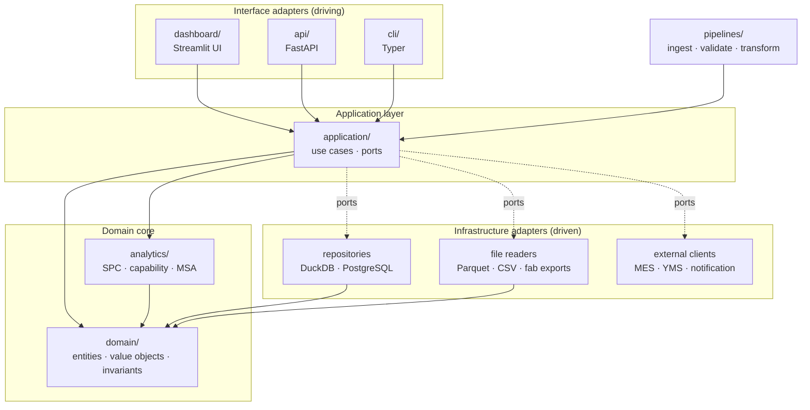
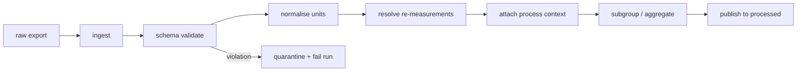
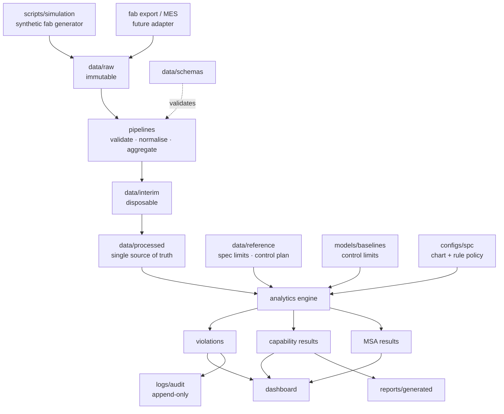
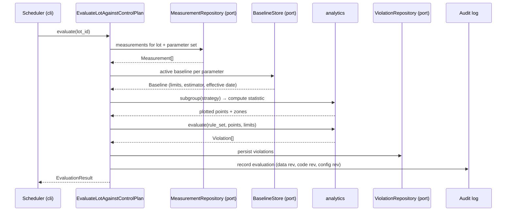
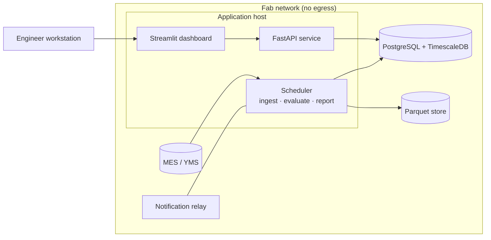

# System Architecture

**Document owner:** Project lead
**Status:** Active — design fixed, implementation not started
**Last updated:** 2026-08-03

This document describes the runtime and logical architecture of the platform:
its layers, components, data flow, and the reasoning behind each boundary. For
the *repository* layout and folder rationale see
[architecture/repository-structure.md](architecture/repository-structure.md);
for individual decisions and the options rejected see
[DECISION_LOG.md](DECISION_LOG.md).

---

## 1. Architectural drivers

Architecture is a response to constraints. These are the ones that shaped this
design, in priority order.

| Driver | Consequence |
|---|---|
| **Statistical correctness must be provable** | The SPC engine is a pure, dependency-free layer, independently verifiable against reference values |
| **The engine must be trustworthy over decades of data** | Baselines and limits are immutable, versioned artefacts; superseded versions are retained |
| **Process knowledge changes faster than code** | Chart selection, rule sets, tool registries are declarative configuration |
| **Every result must be defendable in an audit** | Data revision, code revision, and config revision travel with every output; audit trail is append-only |
| **Deployment is on-premises and network-restricted** | No runtime dependency on any external service; everything runs in an air-gapped network |
| **The UI framework will be replaced** | Presentation is a client of the application layer, never a peer of the analytics engine |
| **An AI agent is a primary contributor** | Boundaries are explicit and enforced by tooling, so they survive contributors who cannot hold the whole system in mind |

## 2. Layering

The system uses a **hexagonal (ports and adapters)** arrangement. Dependencies
point inward, without exception.



### The rules, stated precisely

1. `domain/` imports nothing from this repository and no third-party library
   beyond the standard library and `pydantic` for value validation.
2. `analytics/` imports `domain/` and `common/` only. NumPy, SciPy, and
   statsmodels are permitted here; I/O of any kind is not.
3. `application/` depends on `domain/`, `analytics/`, and **port interfaces it
   defines itself**. It never imports a concrete adapter.
4. `infrastructure/` implements those ports. It is the only place a database
   driver, HTTP client, or file format library appears.
5. `dashboard/`, `api/`, and `cli/` are interchangeable front doors. Each
   parses input, invokes one use case, and renders the result.

Import direction is enforced mechanically by `import-linter` in CI, not by
convention. A rule that depends on reviewer vigilance is a rule that will be
broken.

### Why hexagonal, given the size of the project

The honest answer is that hexagonal architecture is over-engineering for a
CRUD application of this size — and exactly right for this one, for two
specific reasons.

First, the analytics engine must be testable without any infrastructure at
all. Verifying a Cpk calculation should not require a database fixture. Purity
is not an aesthetic preference here; it is what makes the statistical test tier
possible.

Second, the data source is guaranteed to change. Development runs on synthetic
Parquet files; a realistic deployment reads from a fab MES via an entirely
different mechanism. The port boundary means that change touches one adapter
and zero lines of statistical code.

## 3. Component responsibilities

### 3.1 Domain (`src/spc_platform/domain/`)

The vocabulary of wafer fabrication as types. No I/O, no frameworks, no
pandas.

Principal entities and value objects:

| Type | Responsibility | Key invariant |
|---|---|---|
| `Lot`, `Wafer`, `Site` | Material hierarchy | A wafer belongs to exactly one lot; slot ∈ 1..25 |
| `ProcessStep`, `Tool`, `Chamber`, `Recipe` | Equipment and route model | A chamber belongs to exactly one tool |
| `Parameter` | A measurable characteristic | Carries unit and metrology method; unit is never implicit |
| `Measurement` | One value at one site at one time | Value + unit + timestamp + provenance, never a bare float |
| `SpecificationLimit` | Customer/device requirement | `lsl < target < usl`; **cannot be constructed from process data** |
| `ControlLimit` | Process-derived boundary | Carries baseline ID, sigma estimator, effective date; **cannot be constructed from a specification** |
| `Baseline` | Qualified stable period | Immutable once approved; records n, estimator, approver |
| `Subgroup` | Rational grouping for charting | Records the subgrouping strategy that produced it |
| `Violation` | A rule signal at a point | References rule identity, severity, chart, and point |
| `Disposition` | Recorded human decision | Requires actor, timestamp, and reason |

**The `SpecificationLimit` / `ControlLimit` separation is the single most
important type decision in the system.** They are structurally distinct with no
conversion between them, so the most common serious error in SPC tooling —
drawing spec limits as control limits — cannot be expressed in this codebase.
It is a compile-time impossibility rather than a code-review responsibility.

### 3.2 Analytics (`src/spc_platform/analytics/`)

The statistical core. Pure functions, vectorised over NumPy arrays, no
logging of business events, no rendering, no persistence.

```
analytics/
├── charts/        Limit computation per chart type (I-MR, X̄-R, X̄-S, EWMA, CUSUM, p/np/c/u)
├── rules/         Western Electric and Nelson rule evaluation over zoned data
├── capability/    Cp, Cpk, Pp, Ppk, Cpm; short/long-term sigma; non-normal handling
├── msa/           Gauge R&R (ANOVA), bias, linearity, stability, NDC
├── variance/      Nested variance decomposition (within-wafer / wafer / lot / tool)
├── spatial/       Wafer map signature detection: radial, edge, asymmetry
├── distribution/  Normality assessment, Box-Cox and Johnson transformation
└── estimators/    d₂, c₄, and related unbiasing constants, with their sources
```

Two conventions apply throughout and are enforced by rule and review:

- **Every function names its estimator.** There is no function that takes
  "sigma"; there are functions that take `sigma_within` or `sigma_overall`,
  and the caller must choose.
- **Every formula cites its source** in the docstring — NIST/SEMATECH,
  Montgomery, or the original paper ([ADR-0017](DECISION_LOG.md#adr-0017)). A
  reviewer must be able to check the implementation against the reference
  without trusting the author, which is why every cited source is publicly
  obtainable.

### 3.3 Application (`src/spc_platform/application/`)

Use cases, one per meaningful engineering action. Each is a single class or
function with an explicit input and output contract:

- `EvaluateLotAgainstControlPlan` — the central path: load measurements,
  subgroup them, fetch active limits, evaluate rules, emit violations.
- `RecomputeBaseline` — qualify a stable period, compute limits, create a new
  baseline version, supersede the previous one, write the audit record.
- `AcknowledgeViolation` / `RecordDisposition` — the human decision path.
- `GenerateCapabilityReport` — stability check first, then indices, then
  rendering, with refusal if the process is not in control.
- `RunGaugeStudy` — MSA evaluation and acceptability judgement.

Use cases are where **policy** lives: the decision to refuse a capability
report on an out-of-control process is application policy, not a statistical
detail. The analytics layer computes what it is asked; the application layer
decides what may be asked.

### 3.4 Pipelines (`src/spc_platform/pipelines/`)

The path from a raw export to a chartable series, as discrete, independently
testable stages:



Every stage records lineage: input revision, row counts in and out, and the
transformations applied. When a chart looks wrong at 03:00, "which stage did
this?" must be answerable from `logs/pipeline/` without re-running anything.

Schema validation is a **hard stop**, not a warning. Silently coercing a
malformed measurement into a plausible float is the most dangerous failure
mode available to this system, because the result is a confident wrong answer
rather than an error.

### 3.5 Infrastructure (`src/spc_platform/infrastructure/`)

Adapters implementing application-defined ports: measurement repositories,
baseline and configuration stores, file readers for fab export formats,
notification transports, and — behind a port from the start — an MES/YMS client
interface, so that swapping the synthetic source for a real one is an adapter
change.

### 3.6 Cross-cutting concerns

**Configuration** (`config/`) is parsed once at the application boundary into
typed, immutable Pydantic models. No module reads YAML or an environment
variable at import time. The effective configuration, with its revision hash,
is recorded on every analytical output.

**Observability** (`observability/`) provides structured logging, metrics, and
— kept deliberately separate — the audit trail. Operational logs help an
engineer debug and may be rotated away; audit records prove what the system did
and who instructed it, are append-only, and their loss is an audit finding.
Same mechanism, incompatible requirements, separate sinks.

**Audit trail** captures every consequential event: control limit changes and
their approver, baseline recalculations, violation acknowledgements and
dispositions, configuration changes, report generation, and access to
sensitive data. This is what makes the platform a quality system component
rather than a charting tool.

## 4. Principal data flow



Note the two inputs entering the engine from opposite directions and never
mixing: **specification limits** arrive as approved reference data, while
**control limits** arrive as computed, versioned baseline artefacts.

## 5. Key runtime sequence: evaluating a lot



The analytics layer is called twice and holds no state between calls. It never
learns which lot it is looking at, which is what makes it exhaustively
testable.

## 6. Deployment topology

Target environment is **on-premises and network-restricted**, consistent with
how fabs actually operate: process data does not leave the site.



Three deployment profiles are supported, differing only in configuration:

| Profile | Storage | Purpose |
|---|---|---|
| **Local** | DuckDB + Parquet files | Development, notebooks, demonstration; single command, no services |
| **Staging** | PostgreSQL in Docker Compose | Integration and contract testing against real database semantics |
| **Production** | PostgreSQL + TimescaleDB | On-prem deployment with retention policies on time-series data |

The local profile matters more than it appears: a reviewer must be able to
clone the repository and see working control charts within minutes, with no
infrastructure. That requirement is why the storage layer sits behind a port.

Details in [DEPLOYMENT_PLAN.md](DEPLOYMENT_PLAN.md).

## 7. Scale and performance envelope

Design target, sized to a mid-volume 300 mm fab:

| Dimension | Target |
|---|---|
| Measurement records | 10⁷–10⁸ retained; 10⁶/day ingested |
| Parameters under active control | ~2 000 |
| Chart computation (1 000 points, limits + full rule set) | < 50 ms |
| Lot evaluation (all parameters at one step) | < 2 s |
| Dashboard chart load, warm cache | < 1 s |
| Nightly full re-evaluation | < 30 min |

These are budgets, not aspirations: `tests/performance/` asserts them so
regressions surface in CI rather than on a shift lead's screen.

The dominant scaling decision is that **chart computation is vectorised, not
per-point**. Run-rule evaluation over zoned data is expressible as array
operations; a naive per-point loop is roughly two orders of magnitude slower
and fails the budget above at production volume.

## 8. Extension points

Designed-in seams, each already a port or a configuration surface:

- **New chart type** — implement in `analytics/charts/`, register in
  `configs/spc/`; no change to application or UI code.
- **New data source** — implement the measurement repository port in
  `infrastructure/`; no change to analytics.
- **New rule set** — declare in `configs/spc/`; rule primitives are composable.
- **Predictive models** — enter through the same application ports as
  rule-based detection, so they augment rather than bypass the audit trail.
- **Multivariate SPC** (Hotelling T², PCA) — an additional analytics module
  consuming the same subgrouped input.

## 9. SEMI standards alignment

The platform is built for a semiconductor fab, and a fab already has a
vocabulary for equipment structure, equipment state, substrate tracking, and
data collection. Where SEMI has standardised a concept, this architecture uses
SEMI's name and SEMI's meaning rather than inventing a parallel term — because
a parallel vocabulary creates a translation burden at every integration point.

SEMI standards are controlled publications, so this is **conceptual alignment
only**: nothing is reproduced, nothing is a numerical test dependency, and no
conformance is claimed (Layer 3 of
[ADR-0017](DECISION_LOG.md#adr-0017)).

Three alignments have concrete architectural consequences:

**E120 / E125 (Common Equipment Model, equipment self-description)** shape the
domain model. Equipment is a tool → chamber hierarchy rather than a flat
equipment identifier, which is why `chamber_id` is a first-class field on every
measurement and why chamber-level comparison is a design feature rather than an
afterthought.

**E10 (Reliability, Availability, Maintainability)** supplies the equipment
state model, and equipment state is *context for interpreting a control chart*.
Step shifts cluster at state transitions — a return to productive time after
maintenance is the most common physical explanation for a sudden mean shift —
so `Tool` and `Chamber` carry state history in E10 terms, the chart viewer
annotates transitions, and baseline qualification excludes engineering time
rather than absorbing deliberate experimental variation into the control limits.

**E148 (time synchronisation)** underwrites the timezone-aware timestamp rule.
Process tools and metrology tools are separate systems with independent clocks;
skew between them produces misordered series, and a run rule evaluated over a
misordered series signals on nothing real. That failure presents as a
statistical defect and is actually a data integrity defect.

Full treatment, including the equipment communication standards (E5, E30, E37,
E134, E164) that a future ingestion adapter would speak, in
[domain/SEMI_STANDARDS_ALIGNMENT.md](domain/SEMI_STANDARDS_ALIGNMENT.md).

## 10. Deliberate non-goals

Recorded so that later contributors do not mistake absence for oversight:

- **No real-time equipment control.** The platform observes and reports; it
  never issues a command to a tool. Interlocks are a safety-rated concern with
  entirely different engineering requirements.
- **No microservices.** A modular monolith is correct at this scale. Network
  boundaries between components that share a transaction and a release cycle
  would add failure modes and buy nothing.
- **No message broker in the base design.** Batch and scheduled evaluation
  meets the requirement. Streaming would be added only when a use case demands
  sub-minute latency, and none currently does.
- **No cloud services at runtime.** Excluded by the on-premises constraint,
  not by preference.
- **No automated root-cause determination.** The platform assembles evidence —
  commonality, spatial signature, tool comparison — and the engineer concludes.
  A system that asserts causes it cannot justify will be overridden once and
  ignored thereafter.

---

**Related:** [architecture/repository-structure.md](architecture/repository-structure.md) ·
[MODULE_DESIGN.md](MODULE_DESIGN.md) ·
[TECH_STACK.md](TECH_STACK.md) ·
[DECISION_LOG.md](DECISION_LOG.md) ·
[DEPLOYMENT_PLAN.md](DEPLOYMENT_PLAN.md) ·
[TESTING_STRATEGY.md](TESTING_STRATEGY.md)
